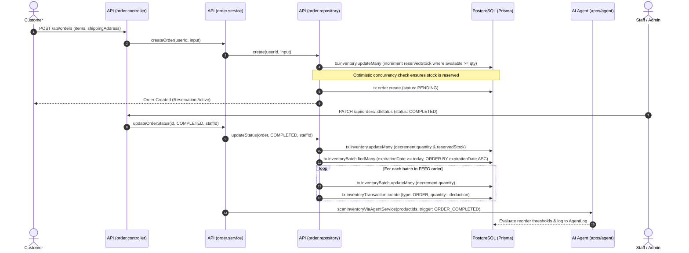

# PROJECT ARCHITECTURAL & SOURCE CODE AUDIT REPORT

> **Document Status**: Official Architecture & Implementation Audit  
> **Target System**: Cafe Management & Autonomous AI Inventory System (`cafe-project`)  
> **Repository Path**: `d:\KLTN\source\cafe-project`  
> **Audit Date**: 2026-11-09  
> **Auditor Role**: Senior Software Architect + Code Auditor  
> **Analysis Mode**: Read-Only Source Code & Schema Inspection (Zero Side Effects)  
> **Execution Status**: 229 Unit/Mock Tests Passed (69 Agent + 145 API + 15 Web) | Real PostgreSQL Persistence: BLOCKED (`POSTGRES_NOT_VERIFIED`)

---

## 1. PROJECT OVERVIEW

The **Cafe Management & Autonomous AI Inventory System** is a full-stack monorepo application designed to manage cafe operations, beverage sales, inventory batch lifecycles (FEFO), dynamic safety stock calculation, and autonomous AI-assisted supplier replenishment.

### 1.1 Repository Structure & Workspaces
The repository is managed using **Turborepo** with **npm workspaces** (`apps/*`, `packages/*`):
- `apps/web`: Single-Page Application (SPA) built with React 18, Vite, and Tailwind CSS.
- `apps/api`: REST API backend built on Express, Prisma ORM, and Zod validation.
- `apps/agent`: Standalone background microservice and cron worker utilizing Google Generative AI (Gemini 1.5 Flash) with deterministic mathematical rule-based fallback.
- `packages/database`: Prisma client, multi-file schema specifications (`prisma/schema/*.prisma`), SQL migrations, and database seeders.
- `packages/types`: Shared TypeScript interfaces across frontend and backend services.
- `packages/eslint-config` & `packages/typescript-config`: Shared linting and compilation configurations.

### 1.2 System Dual-Architecture Reality
The codebase is currently in a transitional state characterized by two parallel architectures:
1. **Production / Legacy Pipeline**:
   - Actively wired to PostgreSQL via Prisma ORM using 15 active models (11 target tables + 4 transitional legacy tables: `Inventory`, `InventoryBatch`, `SupplierProduct`, `AgentLog`).
   - Inventory tracking occurs directly at the finished `Product` level.
   - Reordering AI Agent analyzes stock against dynamic thresholds and generates procurement recommendations logged into `AgentLog`.
2. **Mock-First Domain Workflows (Phases 3 - 8D)**:
   - Located in `apps/api/src/workflows/`, `apps/agent/src/workflows/`, and `apps/web/src/mock/`.
   - Implements raw-material inventory (`Ingredient`, `IngredientBatch`), Bill of Materials (`Recipe`, `RecipeIngredient`), multi-item Goods Receipt split-lots, Stock Count variance audits, and Agent multi-step execution tracing (`AgentExecution`, `AgentToolCall`, `AgentEvaluation`, `MemoryLearning`).
   - Fully passes 229 unit and in-process HTTP tests.
   - **PostgreSQL persistence for this domain is currently BLOCKED** (`POSTGRES_NOT_VERIFIED`), pending finalization of persistence contracts (U1–U6).

---

## 2. ARCHITECTURE & TECH STACK

### 2.1 Technology Stack Summary

| Layer | Technology | Version | Purpose in Codebase |
|---|---|---|---|
| **Runtime** | Node.js | `>=18` (npm 11.6.2) | Application execution environment |
| **Language** | TypeScript | `5.4.5` - `5.9.2` | Static typing across apps and packages |
| **Build Orchestration** | Turborepo | `^2.9.14` | Pipeline execution (`build`, `dev`, `lint`, `check-types`) |
| **Frontend UI** | React | `^18.3.1` | Client-side user interface (`apps/web`) |
| **Bundler & Dev Server** | Vite | `^5.2.11` | Rapid HMR frontend build tool |
| **Styling** | Tailwind CSS | `^3.4.3` | Utility-first CSS framework |
| **Backend Framework** | Express | `^4.19.2` | HTTP Server in `apps/api` |
| **Agent Microservice** | Native `node:http` | Node built-in | Lightweight internal HTTP server on `127.0.0.1:5055` |
| **Database & ORM** | PostgreSQL + Prisma | `^6.19.3` | Relational datastore & ORM (`packages/database`) |
| **Validation** | Zod | `^3.23.8` / `^4.4.3` | Request body validation & schema parsing |
| **Authentication** | JWT + bcrypt | `^9.0.10` / `^6.0.0` | Stateless bearer token auth with salted password hashing |
| **AI LLM Client** | Google Generative AI | `^0.24.1` | Gemini 1.5 Flash client for replenishment reasoning |
| **Task Scheduling** | node-cron | `4.4.1` | Cron jobs in API and Agent workers |
| **Email Service** | Nodemailer | `9.0.1` | SMTP email dispatch for password reset & supplier PRs |
| **Media Storage** | Cloudinary SDK | `^2.10.0` | Cloud-hosted product image asset management |
| **Test Runners** | Node Test Runner / Playwright | `node:test` / `^1.61.1` | In-process contract tests and browser unit tests |

### 2.2 Entry Points & Execution Flows
- **Backend Production Entry**: [`apps/api/src/index.ts`](file:///d:/KLTN/source/cafe-project/apps/api/src/index.ts). Initializes Express, connects Prisma, mounts `/api/*` routes, and starts HTTP server on port `5000`.
- **Backend Mock Entry**: [`apps/api/src/workflows/server.ts`](file:///d:/KLTN/source/cafe-project/apps/api/src/workflows/server.ts). Bootstraps `createMockHttpApp` mounted at `/api/mock`, strictly enabled only when `DATA_PROVIDER=mock`.
- **Agent Server Entry**: [`apps/agent/src/server.ts`](file:///d:/KLTN/source/cafe-project/apps/agent/src/server.ts). Internal HTTP listener on `127.0.0.1:5055` handling `/internal/agent/*` calls authenticated via `x-agent-internal-token`.
- **Agent Worker Entry**: [`apps/agent/src/worker.ts`](file:///d:/KLTN/source/cafe-project/apps/agent/src/worker.ts). Scheduled worker running `initInventoryScanJob()` driven by the `ai.scanCron` system setting.
- **Frontend SPA Entry**: [`apps/web/src/main.tsx`](file:///d:/KLTN/source/cafe-project/apps/web/src/main.tsx) & [`apps/web/src/App.tsx`](file:///d:/KLTN/source/cafe-project/apps/web/src/App.tsx). Renders `AppRoutes` with role-based routing (`AdminRoute`, `AdminOnlyRoute`, `ProtectedRoute`).

---

## 3. MODULE INVENTORY

### 3.1 Backend API Modules (`apps/api/src/modules/`)

| Module Name | File Path | Responsibilities & Observed Implementation |
|---|---|---|
| **Auth** | [`apps/api/src/modules/auth`](file:///d:/KLTN/source/cafe-project/apps/api/src/modules/auth) | User registration, login, JWT issuance (`auth.tokens.ts`), bcrypt password hashing, Google OAuth token verification, password reset email via Nodemailer. Enforces database lookup of current user status on each request (`auth.middleware.ts#L39`). |
| **Product** | [`apps/api/src/modules/product`](file:///d:/KLTN/source/cafe-project/apps/api/src/modules/product) | Product catalog master, automated SKU generation, category binding, soft-delete with grace period, and image association. |
| **Category** | [`apps/api/src/modules/category`](file:///d:/KLTN/source/cafe-project/apps/api/src/modules/category) | Product category management (`kind = 'PRODUCT'`). |
| **Inventory** | [`apps/api/src/modules/inventory`](file:///d:/KLTN/source/cafe-project/apps/api/src/modules/inventory) | Stock level tracking, manual stock import with batch codes, manual stock adjustments with batch validation, FEFO batch selection, dynamic threshold suggestions based on sales velocity and lead time. |
| **Order** | [`apps/api/src/modules/order`](file:///d:/KLTN/source/cafe-project/apps/api/src/modules/order) | Order placement with stock reservations, shipping fee calculation by district zone, order state transitions (`PENDING` -> `PROCESSING` -> `COMPLETED` / `CANCELLED`), FEFO batch stock deduction upon `COMPLETED`, stock release upon `CANCELLED`. |
| **Payment** | [`apps/api/src/modules/payment`](file:///d:/KLTN/source/cafe-project/apps/api/src/modules/payment) | Basic payment status management attached to orders (`PENDING`, `PAID`, `FAILED`). Real payment gateways are not integrated. |
| **Purchase** | [`apps/api/src/modules/purchase`](file:///d:/KLTN/source/cafe-project/apps/api/src/modules/purchase) | Purchase request lifecycle (`PENDING` -> `APPROVED` -> `SENT` -> `RECEIVED`), supplier quotation email dispatch via Nodemailer, goods receipt intake directly updating `Inventory` and `InventoryBatch`. |
| **Simulate Sale** | [`apps/api/src/modules/simulate-sale`](file:///d:/KLTN/source/cafe-project/apps/api/src/modules/simulate-sale) | Administrative testing harness to simulate sales velocities across products, deduct stock, trigger AI Agent reordering evaluation, and cleanly restore inventory state (`restoreSale`). |
| **Supplier** | [`apps/api/src/modules/supplier`](file:///d:/KLTN/source/cafe-project/apps/api/src/modules/supplier) | Supplier directory, active/inactive flags, contact information, and supplier-product pricing/lead time mappings. |
| **System Setting** | [`apps/api/src/modules/system-setting`](file:///d:/KLTN/source/cafe-project/apps/api/src/modules/system-setting) | Key-value store for system runtime parameters (`ai.enabled`, `ai.scanCron`, `store.name`, etc.). |
| **Dashboard** | [`apps/api/src/modules/dashboard`](file:///d:/KLTN/source/cafe-project/apps/api/src/modules/dashboard) | Aggregates daily/weekly revenue, pending orders, low stock items, and recent activity logs. |
| **Upload** | [`apps/api/src/modules/upload`](file:///d:/KLTN/source/cafe-project/apps/api/src/modules/upload) | Multipart file handling via Multer and image upload/deletion via Cloudinary SDK. |
| **User** | [`apps/api/src/modules/user`](file:///d:/KLTN/source/cafe-project/apps/api/src/modules/user) | Administrative user listing, role modification (`ADMIN`, `STAFF`, `CUSTOMER`), and account deactivation. |
| **Agent Client** | [`apps/api/src/modules/agent`](file:///d:/KLTN/source/cafe-project/apps/api/src/modules/agent) | Internal HTTP client dispatching authenticated calls to `apps/agent` using `x-agent-internal-token`. |

### 3.2 Agent Service Modules (`apps/agent/src/`)

| Module Name | File Path | Responsibilities & Observed Implementation |
|---|---|---|
| **Server** | [`apps/agent/src/server.ts`](file:///d:/KLTN/source/cafe-project/apps/agent/src/server.ts) | Node HTTP server listening on loopback (`127.0.0.1:5055`), enforcing `x-agent-internal-token` and role headers. |
| **Worker** | [`apps/agent/src/worker.ts`](file:///d:/KLTN/source/cafe-project/apps/agent/src/worker.ts) | Background process handling startup scans (`--scan-once`) and cron scheduling. |
| **Recommendation Service** | [`apps/agent/src/services/recommendation.service.ts`](file:///d:/KLTN/source/cafe-project/apps/agent/src/services/recommendation.service.ts) | replenishment calculation combining sales velocity, supplier MOQ, lead time, and packaging conversions. Invokes Gemini LLM when enabled or falls back to rule-based mathematical formulas. |
| **Gemini Service** | [`apps/agent/src/services/gemini.service.ts`](file:///d:/KLTN/source/cafe-project/apps/agent/src/services/gemini.service.ts) | Gemini 1.5 Flash client with JSON code-fence cleaning, schema shape validation, and credential isolation. |
| **Agent Repository** | [`apps/agent/src/repositories/agent.repository.ts`](file:///d:/KLTN/source/cafe-project/apps/agent/src/repositories/agent.repository.ts) | Prisma queries fetching product, inventory, and supplier records, and logging actions to `AgentLog`. |
| **Mock Agent Workflow** | [`apps/agent/src/workflows/agent-workflow.ts`](file:///d:/KLTN/source/cafe-project/apps/agent/src/workflows/agent-workflow.ts) | In-memory agent runtime implementing tool execution, multi-line proposals, ADMIN approval lifecycles, and memory learning. |

---

## 4. BUSINESS WORKFLOWS TRACEABILITY

### 4.1 Customer Ordering & Stock Depletion (FEFO)

### 4.2 Autonomous AI Replenishment & Goods Receipt
1. **Trigger**: An inventory level changes (via `ORDER_COMPLETED`, `INVENTORY_ADJUSTED`, `SIMULATE_SALE`), or the background cron worker (`inventory-scan.job.ts`) executes.
2. **Threshold Evaluation**: [`recommendation.service.ts`](file:///d:/KLTN/source/cafe-project/apps/agent/src/services/recommendation.service.ts#L110) calculates whether available stock `(quantity - reservedStock) <= reorderPoint`.
3. **Supplier Selection**:
   - Active suppliers linked via `SupplierProduct` are filtered.
   - Evaluated by preferred status, unit price, lead time, and MOQ.
4. **Recommendation Generation**:
   - If `AGENT_RECOMMENDATION_MODE=gemini` and `GEMINI_API_KEY` is present, prompt is sent to Gemini 1.5 Flash.
   - If Gemini fails or mode is `rule-based`, mathematical fallback is computed (`calculateRuleBased`).
   - The result is logged to `AgentLog` with action `RECOMMEND_REORDER`.
5. **Purchase Request Creation**: Admin reviews recommendation and clicks create PR -> `POST /internal/agent/recommendations/:id/create-purchase-request` -> Creates `PurchaseRequest` in status `PENDING`.
6. **Approval & Email Dispatch**: Admin approves PR (`PATCH /api/purchase-requests/:id/status`) -> status becomes `APPROVED` / `SENT` -> Nodemailer dispatches formal quotation email to supplier.
7. **Goods Receipt**: Admin records receipt (`POST /api/purchase-requests/:id/receive`) -> `Inventory.quantity` is incremented, a new `InventoryBatch` is created with expiry date, and `InventoryTransaction` (`type: IMPORT`) is recorded.

---

## 5. IMPLEMENTED VS. MOCK VS. MISSING MATRIX

| Capability / Feature | Production (PostgreSQL) | Mock Workflows (`/api/mock`) | Status Classification | Evidence in Source Code |
|---|:---:|:---:|:---:|---|
| **User Auth & Roles** | **IMPLEMENTED** | **IMPLEMENTED** | **VERIFIED** | [`auth.service.ts#L52`](file:///d:/KLTN/source/cafe-project/apps/api/src/modules/auth/auth.service.ts#L52), [`auth.middleware.ts#L27`](file:///d:/KLTN/source/cafe-project/apps/api/src/modules/auth/auth.middleware.ts#L27) |
| **Product Master & Categories** | **IMPLEMENTED** | **IMPLEMENTED** | **VERIFIED** | [`product.service.ts`](file:///d:/KLTN/source/cafe-project/apps/api/src/modules/product/product.service.ts), [`category.service.ts`](file:///d:/KLTN/source/cafe-project/apps/api/src/modules/category/category.service.ts) |
| **Product-Level Inventory** | **IMPLEMENTED** | N/A | **VERIFIED** | [`inventory.service.ts#L355`](file:///d:/KLTN/source/cafe-project/apps/api/src/modules/inventory/inventory.service.ts#L355), [`inventory.repository.ts`](file:///d:/KLTN/source/cafe-project/apps/api/src/modules/inventory/inventory.repository.ts) |
| **FEFO Batch Deduction** | **IMPLEMENTED** | **IMPLEMENTED** | **VERIFIED** | [`order.repository.ts#L165`](file:///d:/KLTN/source/cafe-project/apps/api/src/modules/order/order.repository.ts#L165), [`inventory-core.ts`](file:///d:/KLTN/source/cafe-project/apps/api/src/common/inventory-core.ts) |
| **AI Replenishment Recommendation** | **IMPLEMENTED** | **IMPLEMENTED** | **VERIFIED** | [`gemini.service.ts#L23`](file:///d:/KLTN/source/cafe-project/apps/agent/src/services/gemini.service.ts#L23), [`recommendation.service.ts#L244`](file:///d:/KLTN/source/cafe-project/apps/agent/src/services/recommendation.service.ts#L244) |
| **Purchase Request Lifecycle** | **IMPLEMENTED** | **IMPLEMENTED** | **VERIFIED** | [`purchase.service.ts`](file:///d:/KLTN/source/cafe-project/apps/api/src/modules/purchase/purchase.service.ts) |
| **Sales Simulation & Rollback** | **IMPLEMENTED** | N/A | **VERIFIED** | [`simulate-sale.service.ts#L240`](file:///d:/KLTN/source/cafe-project/apps/api/src/modules/simulate-sale/simulate-sale.service.ts#L240) |
| **Recipe / BOM Management** | **MISSING** (0 DB hits) | **MOCK ONLY** | **MOCK_VERIFIED** | `Recipe`, `RecipeIngredient` in [`schema/inventory.prisma`](file:///d:/KLTN/source/cafe-project/packages/database/prisma/schema/inventory.prisma#L30); Mock in [`contracts.ts`](file:///d:/KLTN/source/cafe-project/apps/api/src/workflows/contracts.ts) |
| **Ingredient-Level Inventory** | **MISSING** (0 DB hits) | **MOCK ONLY** | **MOCK_VERIFIED** | `Ingredient`, `IngredientBatch` in [`schema/inventory.prisma`](file:///d:/KLTN/source/cafe-project/packages/database/prisma/schema/inventory.prisma#L1); Mock in [`mock-repository.ts`](file:///d:/KLTN/source/cafe-project/apps/api/src/workflows/mock-repository.ts) |
| **Formal Goods Receipts & Split Lots** | **MISSING** (0 DB hits) | **MOCK ONLY** | **MOCK_VERIFIED** | `GoodsReceipt` in [`schema/purchase.prisma`](file:///d:/KLTN/source/cafe-project/packages/database/prisma/schema/purchase.prisma#L65); Mock in [`business-service.ts`](file:///d:/KLTN/source/cafe-project/apps/api/src/workflows/business-service.ts) |
| **Stock Count Audits (Reconciliation)**| **MISSING** (0 DB hits) | **MOCK ONLY** | **MOCK_VERIFIED** | `StockCount`, `StockCountItem` in [`schema/inventory.prisma`](file:///d:/KLTN/source/cafe-project/packages/database/prisma/schema/inventory.prisma#L125); Mock in [`mock-workflows.test.cjs`](file:///d:/KLTN/source/cafe-project/apps/api/tests/mock-workflows.test.cjs) |
| **Payment Gateway Integration** | **SIMULATED** | **MOCK ONLY** | **UNVERIFIED** | Manual status change only; no external gateway (VNPay/MoMo/Stripe). `PaymentCallback` has 0 hits. |
| **Agent Execution / Memory Learning** | **MISSING** (0 DB hits) | **MOCK ONLY** | **MOCK_VERIFIED** | `AgentExecution`, `AgentToolCall`, `AgentEvaluation` in [`schema/system.prisma`](file:///d:/KLTN/source/cafe-project/packages/database/prisma/schema/system.prisma#L1); Mock in [`agent-workflow.ts#L59`](file:///d:/KLTN/source/cafe-project/apps/agent/src/workflows/agent-workflow.ts#L59) |

---

## 6. CODE QUALITY & SECURITY FINDINGS

### 6.1 Authentication & Authorization
- **Positive Findings**:
  - Registration strictly forces `role = 'CUSTOMER'` ([`auth.service.ts`](file:///d:/KLTN/source/cafe-project/apps/api/src/modules/auth/auth.service.ts)); client payloads cannot escalate privileges to `ADMIN` or `STAFF`.
  - Passwords hashed using `bcrypt` with 10 salt rounds.
  - JWT tokens are signed using HMAC-SHA256 with minimum length validation (`auth.tokens.ts`).
  - Active Account Invariant: [`auth.middleware.ts#L39`](file:///d:/KLTN/source/cafe-project/apps/api/src/modules/auth/auth.middleware.ts#L39) queries the database for the user record on every authenticated request. A revoked, deleted, or demoted user immediately loses access even if their token has not expired.
- **Vulnerabilities / Risks**:
  - Missing Rate Limiting: No rate-limiting middleware (`express-rate-limit`) is applied to sensitive authentication routes (`/api/auth/login`, `/api/auth/register`, `/api/auth/forgot-password`), leaving endpoints open to brute-force credential stuffing.

### 6.2 Agent Microservice Security
- **Positive Findings**:
  - Network Isolation: The agent server explicitly binds to `127.0.0.1` (`AGENT_HOST`), preventing external exposure.
  - Mutual Token Authentication: Requires `x-agent-internal-token` validated via `validInternalToken`. Requests missing or presenting mismatched tokens fail closed with 401.
  - LLM Sanitization: [`gemini.service.ts#L25`](file:///d:/KLTN/source/cafe-project/apps/agent/src/services/gemini.service.ts#L25) wraps Google SDK calls in a generic catch block that rethrows sanitized errors, preventing prompt text, internal URLs, or credentials from leaking into server logs or HTTP responses.
  - Strict Schema Validation: LLM JSON responses are cleaned of markdown fences and parsed with rigorous type and range checks (positive finite numbers, bounds `0 <= confidence <= 1`, non-empty strings) before being accepted.

### 6.3 Concurrency & Data Integrity
- **Optimistic Concurrency**:
  - Order creation verifies `availableStock >= requestedQuantity` inside Prisma transaction using `updateMany` conditions.
  - Batch deduction in [`order.repository.ts#L184`](file:///d:/KLTN/source/cafe-project/apps/api/src/modules/order/order.repository.ts#L184) uses a retry loop with conditional update: `where: { id: batch.id, quantity: { gte: deduction } }`.
- **Architectural Bottleneck**:
  - In high-concurrency environments, retrying up to 5 times at the application level can cause transaction contention and database lock timeouts. True database row-level locking (`SELECT ... FOR UPDATE`) is not currently implemented in Prisma client calls.

---

## 7. TEST & VERIFICATION STATUS

### 7.1 Verification Summary

| Test Suite | Location | Tests Run | Pass | Fail | Execution Duration | Status |
|---|---|:---:|:---:|:---:|:---:|:---:|
| **Agent Test Suite** | `apps/agent/tests/*.test.cjs` | 69 | 69 | 0 | 12.0s | **VERIFIED (Unit/Mock)** |
| **API Test Suite** | `apps/api/tests/*.test.cjs` | 145 | 145 | 0 | 25.6s | **VERIFIED (Unit/Mock)** |
| **Web Test Suite** | `apps/web/tests/*.test.cjs` | 15 | 15 | 0 | 76.4s | **VERIFIED (Unit/Mock)** |
| **Total Monorepo Tests** | — | **229** | **229** | **0** | **~114s** | **ALL SUITES PASS** |

### 7.2 Nature of the Tests
- **All 229 tests run against in-memory mocks** (`vm.runInNewContext`, mock repository proxies, or mocked Express HTTP handlers).
- **Zero integration tests run against a real PostgreSQL container**. Database constraints, foreign key cascades, unique indices, and SQL triggers remain **UNVERIFIED against live PostgreSQL**.

---

## 8. TECHNICAL DEBT

1. **Dual Schema Schism (31 vs 15 vs 27 Tables)**:
   - 31 models defined in Prisma schema files.
   - 15 models actively wired to backend services.
   - 16 models have 0 reads or writes across the entire codebase.
   - The "27 tables" target requires dropping 4 legacy tables (`Inventory`, `InventoryBatch`, `SupplierProduct`, `AgentLog`), but the backend relies on them.
2. **Blocked Migration Hazard**:
   - `packages/database/prisma/migration_27_tables/04_contract_DO_NOT_RUN_YET.sql` drops the 4 legacy tables.
   - Running this migration on a live database will instantly trigger fatal HTTP 500 errors across `apps/api` and `apps/agent`.
3. **Simulated Payment System**:
   - Payment flows are purely administrative state toggles. There is no cryptographic verification, payment intent lifecycle, webhook signature verification, or ledger reconciliation.
4. **Code Duplication between Legacy & Mock**:
   - Parallel business logic exists in `inventory.service.ts` (product-level) and `business-service.ts` / `inventory-core.ts` (ingredient-level).

---

## 9. PRIORITIZED IMPROVEMENT ROADMAP

### P0 — CRITICAL: Database Persistence Adapter for Contracts
- **Issue**: The rich domain implemented in `apps/api/src/workflows/` and `apps/agent/src/workflows/` (Recipe, Ingredient batches, Goods receipt, Stock counts) only runs in memory.
- **Action**: Implement PostgreSQL repository adapters satisfying `apps/api/src/workflows/contracts.ts` using Prisma models (`Ingredient`, `Recipe`, `GoodsReceipt`, etc.).
- **Impact**: Enables actual persistence for the 16 unintegrated tables without breaking legacy code.

### P1 — HIGH: Safe Migration Bridge (Preserve Legacy during Transition)
- **Issue**: Running migration `04_contract` drops tables that `apps/api` requires.
- **Action**: Implement database views or dual-write triggers mapping `Product.Inventory` to `Ingredient` / `IngredientBatch` before dropping legacy columns. Keep safety lock on `04_contract_DO_NOT_RUN_YET.sql`.

### P2 — HIGH: PostgreSQL Integration Test Suite
- **Issue**: 100% of current tests run in-memory; real database transaction rollbacks and constraints are unverified.
- **Action**: Add an automated integration test runner using a local PostgreSQL container (`docker-compose.yml`) verifying migrations and foreign key constraints.

### P3 — MEDIUM: Security Hardening (Rate Limiting & Security Headers)
- **Issue**: Public authentication routes lack brute-force protection.
- **Action**: Install and configure `express-rate-limit` on `/api/auth/*` and apply `helmet` middleware for HTTP response header sanitization.

### P4 — MEDIUM: Payment Gateway Webhook Integration
- **Issue**: Payment callbacks and reconciliation tables are unused.
- **Action**: Implement webhook endpoints (`/api/payments/callback`) with HMAC-SHA256 signature verification for a standard gateway (e.g., PayOS, MoMo, or VNPay).

---

## 10. UNKNOWNS & UNVERIFIED AREAS

1. **Live PostgreSQL Performance & Row Locks**: Real PostgreSQL locking behavior under multi-client high-concurrency order placement is unverified (only verified in-memory with single-process Node).
2. **External LLM Latency & Cost**: Behavior of Gemini 1.5 Flash under heavy sustained cafe operations (token limits, latency spikes, API quota exhaustion) is unverified in live environments.
3. **Cloudinary Asset Retention**: Automated lifecycle cleanup of orphaned product images upon product deletion is unverified.

