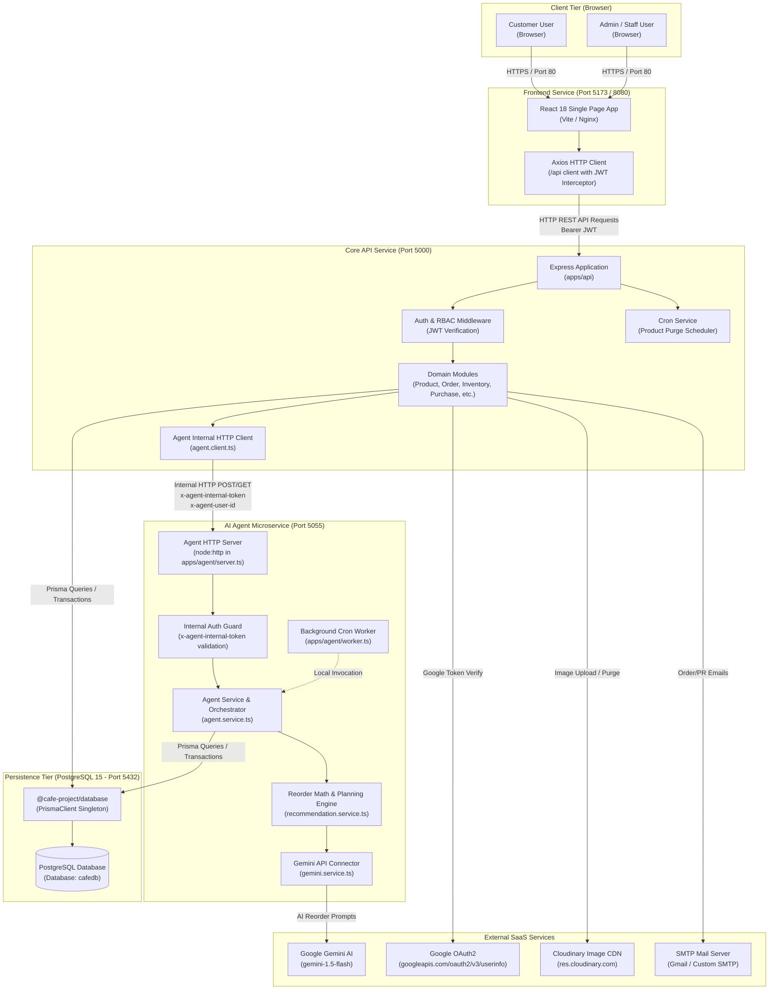
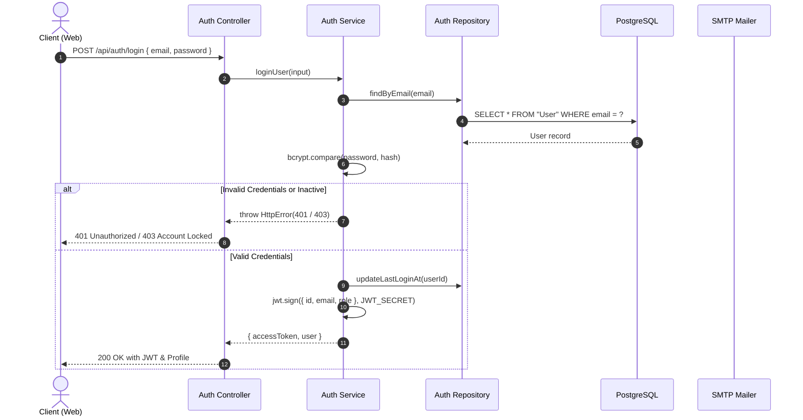
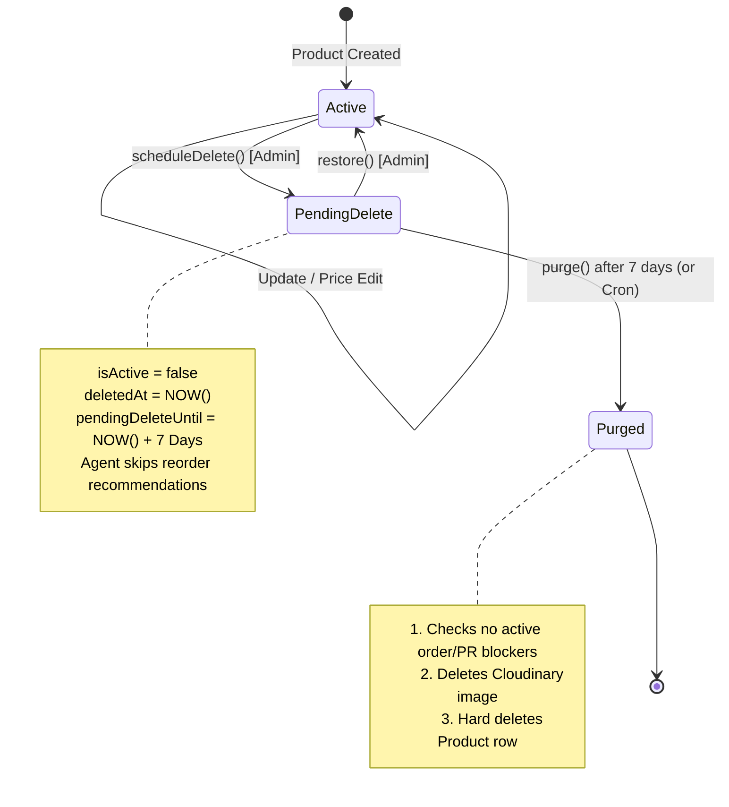
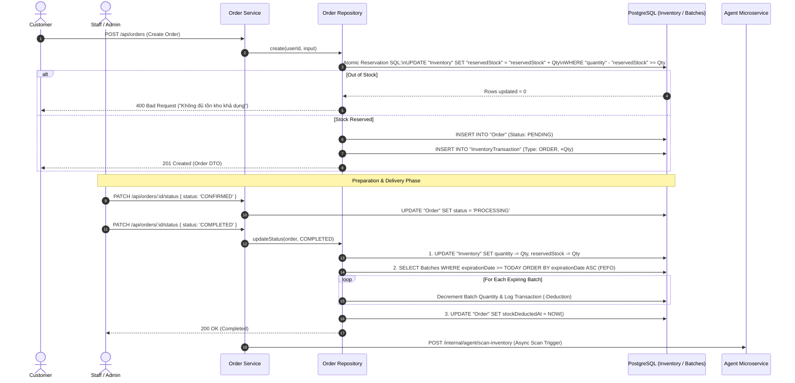
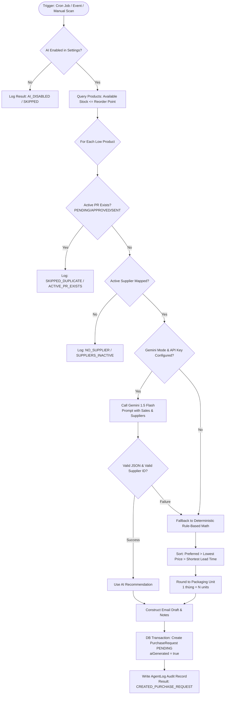
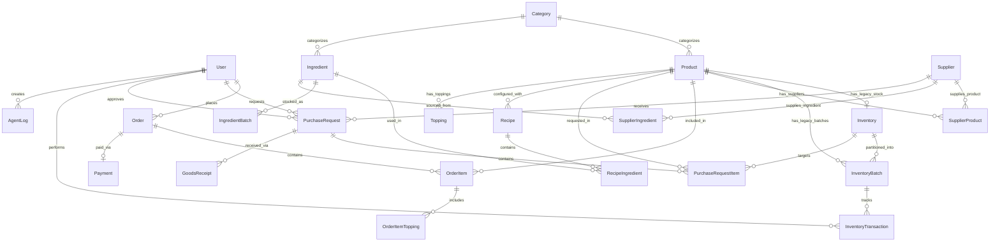

# FULL SOURCE CODE, ARCHITECTURE & BUSINESS LOGIC ANALYSIS REPORT

> **Document Status**: Official Architecture & Implementation Audit  
> **Target System**: Cafe Management & Autonomous AI Inventory System (`cafe-project`)  
> **Repository Path**: `d:\KLTN\source\cafe-project`  
> **Audit Date**: 2026-11-04  
> **Analysis Mode**: Read-Only Source Code Inspection (Zero Side Effects)  
> **Source Commit Context**: Monorepo HEAD (Turborepo + npm workspaces)

---

## TABLE OF CONTENTS

1. [Project Overview](#1-project-overview)
2. [Technology Stack](#2-technology-stack)
3. [Project Directory Structure](#3-project-directory-structure)
4. [System Architecture Diagram](#4-system-architecture-diagram)
5. [Module Responsibilities and Dependencies](#5-module-responsibilities-and-dependencies)
6. [Business Features and Workflows](#6-business-features-and-workflows)
   - [6.1. Authentication, OAuth & Profile Lifecycle](#61-authentication-oauth--profile-lifecycle)
   - [6.2. Product Catalog, SKU Generation & Soft Delete / Purge](#62-product-catalog-sku-generation--soft-delete--purge)
   - [6.3. Inventory Management, Batches & Dynamic Threshold Suggestion](#63-inventory-management-batches--dynamic-threshold-suggestion)
   - [6.4. Customer Ordering, Stock Reservation & FEFO Deduction](#64-customer-ordering-stock-reservation--fefo-deduction)
   - [6.5. Autonomous AI Inventory Monitoring & Reordering (Agent)](#65-autonomous-ai-inventory-monitoring--reordering-agent)
   - [6.6. Purchase Request Lifecycle, Email Dispatch & Goods Receipt](#66-purchase-request-lifecycle-email-dispatch--goods-receipt)
   - [6.7. Sale Simulation & State Restoration](#67-sale-simulation--state-restoration)
7. [Database Architecture and Data Flows](#7-database-architecture-and-data-flows)
   - [7.1. Schema Overview: Legacy vs Expanded Models](#71-schema-overview-legacy-vs-expanded-models)
   - [7.2. Entity Relationships & Foreign Keys](#72-entity-relationships--foreign-keys)
   - [7.3. Concurrency Controls & Critical Invariants](#73-concurrency-controls--critical-invariants)
8. [API and Integration Analysis](#8-api-and-integration-analysis)
   - [8.1. API Gateway Endpoints (`apps/api`)](#81-api-gateway-endpoints-appsapi)
   - [8.2. Internal Agent Microservice Endpoints (`apps/agent`)](#82-internal-agent-microservice-endpoints-appsagent)
   - [8.3. External Third-Party Integrations](#83-external-third-party-integrations)
9. [Implementation Status Matrix](#9-implementation-status-matrix)
10. [Identified Issues and Risks](#10-identified-issues-and-risks)
11. [Unverified Areas and Missing Evidence](#11-unverified-areas-and-missing-evidence)

---

## 1. PROJECT OVERVIEW

The **Cafe Management & Autonomous AI Inventory System** is a full-stack, enterprise-grade application designed for cafe operations, e-commerce beverage sales, inventory batch management, and automated supplier procurement driven by an AI Agent.

### Primary Capabilities
- **Customer Facing Portal**: Responsive catalog browsing, real-time stock availability, cart management, address-based shipping fee calculation, and order tracking.
- **Admin & Operations Dashboard**: High-level KPI dashboards, product/category management, multi-supplier mapping, inventory batch tracking (FEFO), stock manual adjustments, and purchase order lifecycles.
- **Autonomous AI Inventory Agent**: Background microservice combining scheduled cron jobs and event-driven triggers. When inventory dips below dynamic or static thresholds, the agent selects optimal suppliers based on price, MOQ, and lead time, drafts formal procurement quotation emails, and creates purchase requests pending admin confirmation.
- **Sales Simulation Testing Harness**: An administrative sandbox allowing staff to simulate arbitrary sales velocities across product subsets, deplete stock, verify automated agent reaction, and cleanly rollback mutations.

### Monorepo Architecture
The repository uses **Turborepo** with **npm workspaces**, segregated into applications (`apps/*`) and reusable shared packages (`packages/*`):
- `apps/web`: Single-Page Application (SPA) built with React 18, Vite, and Tailwind CSS.
- `apps/api`: REST API backend built on Express, Prisma ORM, and Zod validation.
- `apps/agent`: Standalone background microservice and cron worker utilizing `@google/generative-ai` with rule-based mathematical fallbacks.
- `packages/database`: Centralized Prisma client, multi-file schema specifications, SQL migration scripts, and seeders.
- `packages/types`: Shared TypeScript interfaces and contracts across frontend and backend.
- `packages/eslint-config` & `packages/typescript-config`: Shared linting and build standards.

---

## 2. TECHNOLOGY STACK

| Layer / Concern | Technology | Version | Purpose in Codebase |
|---|---|---|---|
| **Language Runtime** | Node.js | `>=18` (npm 11.6.2) | Core execution environment across all services |
| **Language** | TypeScript | `5.4.5` - `5.9.2` | Static typing across apps and packages |
| **Monorepo Build** | Turborepo | `^2.9.14` | Pipeline execution (`build`, `dev`, `lint`, `check-types`) |
| **Frontend Framework** | React | `^18.3.1` | User interface in [`apps/web`](file:///d:/KLTN/source/cafe-project/apps/web/package.json) |
| **Frontend Bundler** | Vite | `^5.2.11` | Build tooling and development server |
| **Frontend Routing** | React Router DOM | `^6.23.1` | Client-side routing with role guards |
| **CSS Styling** | Tailwind CSS | `^3.4.3` | Utility-first responsive design |
| **HTTP Client (Web)** | Axios | `^1.6.8` | Interceptor-based API client with auth handling |
| **Icons & UI Extras** | Lucide React | `^0.378.0` | Iconography; Canvas Confetti for celebrations |
| **Backend Framework** | Express | `^4.19.2` | HTTP Server in [`apps/api`](file:///d:/KLTN/source/cafe-project/apps/api/package.json) |
| **Validation** | Zod | `^4.4.3` (3.23.8) | Input validation schemas and request body sanitization |
| **Database & ORM** | PostgreSQL + Prisma ORM | `^6.19.3` | Primary persistent datastore with multi-file schema |
| **Database Container** | PostgreSQL Docker | `15-alpine` | Defined in [`docker-compose.yml`](file:///d:/KLTN/source/cafe-project/docker-compose.yml) |
| **Authentication** | JWT (`jsonwebtoken`) + bcrypt | `^9.0.3` / `^6.0.0` | Stateless bearer token auth with salted password hashing |
| **Agent Microservice** | Native `node:http` | Node built-in | Lightweight internal microservice in [`apps/agent`](file:///d:/KLTN/source/cafe-project/apps/agent/src/server.ts) |
| **AI LLM Engine** | Google Generative AI | `^0.24.1` | Gemini 1.5 Flash client for intelligent reordering |
| **Job Scheduling** | node-cron | `^4.4.1` | Background cron triggers in API and Agent |
| **Email Service** | Nodemailer | `^9.0.1` | SMTP email dispatch for password reset & supplier PRs |
| **Media Storage** | Cloudinary SDK | `^2.10.0` | Cloud-hosted product image storage and deletion |
| **Testing** | Node Test Runner / Playwright | Node `node:test` / `^1.61.1` | Mocked contract tests & Playwright config |

---

## 3. PROJECT DIRECTORY STRUCTURE

```text
cafe-project/
├── .github/                            # CI/CD workflows (if present)
├── apps/
│   ├── agent/                          # AI Agent Microservice & Worker
│   │   ├── src/
│   │   │   ├── config/                 # Env variables, system prompts
│   │   │   │   ├── env.ts              # Agent environment parsing
│   │   │   │   └── system-prompt.ts    # Prompt template for Gemini reordering
│   │   │   ├── errors/                 # HttpError classes
│   │   │   ├── jobs/                   # Cron job registrations
│   │   │   │   └── inventory-scan.job.ts# Scheduled inventory scanner
│   │   │   ├── repositories/           # Prisma data queries for Agent
│   │   │   │   └── agent.repository.ts # Inventory & Log queries
│   │   │   ├── services/               # Core intelligence services
│   │   │   │   ├── agent.service.ts    # Main scan & log orchestrator
│   │   │   │   ├── gemini.service.ts   # Google Gemini API connector
│   │   │   │   └── recommendation.service.ts # Demand math & fallback
│   │   │   ├── utils/                  # Reorder point math, logger, encoding
│   │   │   ├── internal-auth.ts        # x-agent-internal-token security guards
│   │   │   ├── public-api.ts           # Re-exports for consumers
│   │   │   ├── server.ts               # Custom node:http internal HTTP server
│   │   │   ├── worker.ts               # Cron and CLI scan runner
│   │   │   └── index.ts                # Launches both server & worker
│   │   ├── tests/                      # Agent internal contract tests
│   │   ├── Dockerfile                  # Container definition for Agent
│   │   └── package.json
│   ├── api/                            # Backend REST API Server
│   │   ├── src/
│   │   │   ├── common/                 # Async wrapper, Cloudinary, Env, Error, Upload
│   │   │   │   ├── async-handler.ts    # Controller try/catch wrapper
│   │   │   │   ├── cloudinary.ts       # Cloudinary upload & delete helpers
│   │   │   │   ├── env.ts              # API environment configuration
│   │   │   │   ├── error-handler.ts    # Global Express error middleware
│   │   │   │   ├── http-error.ts       # Custom HTTP exception with status code
│   │   │   │   ├── response.ts         # Uniform API JSON envelope format
│   │   │   │   ├── upload.ts           # Multer memory storage config
│   │   │   │   └── validate.ts         # Zod validation middleware
│   │   │   ├── modules/                # Feature-based domain modules
│   │   │   │   ├── agent/              # Client to agent microservice & failure logger
│   │   │   │   ├── auth/               # Login, Register, Google OAuth, Reset Password
│   │   │   │   ├── category/           # Product Categories CRUD
│   │   │   │   ├── cron/               # Scheduled Product Purge & Scan hooks
│   │   │   │   ├── dashboard/          # Metric aggregation for Admin/Staff
│   │   │   │   ├── email/              # SMTP Supplier email preview & dispatch
│   │   │   │   ├── inventory/          # Stock levels, import, adjust, suggest threshold
│   │   │   │   ├── order/              # Orders, shipping fee calculation, transitions
│   │   │   │   ├── payment/            # Manual payment verification & status updates
│   │   │   │   ├── product/            # Products, SKU auto-gen, soft delete, purge
│   │   │   │   ├── purchase/           # Purchase Requests, approvals, goods receipt
│   │   │   │   ├── simulate-sale/      # Test harness for depleting stock
│   │   │   │   ├── supplier/           # Suppliers & SupplierProduct mappings
│   │   │   │   ├── system-setting/     # Dynamic key-value configuration
│   │   │   │   ├── upload/             # Image file upload endpoint
│   │   │   │   └── user/               # User management (Admin only)
│   │   │   └── index.ts                # Express app initialization & route registration
│   │   ├── tests/                      # In-process mock-based integration tests
│   │   ├── Dockerfile                  # Container definition for API
│   │   └── package.json
│   └── web/                            # React 18 Frontend SPA
│       ├── src/
│       │   ├── api/                    # Axios API service clients (auth, inventory, etc.)
│       │   ├── components/             # Reusable UI (Admin sidebar, DataTable, Modal, Button)
│       │   ├── contexts/               # React Contexts (AuthContext, CartContext, ToastContext)
│       │   ├── layouts/                # AdminLayout, CustomerLayout
│       │   ├── pages/                  # Customer and Admin route page views
│       │   │   ├── admin/              # 16 Admin management pages
│       │   │   └── ...                 # Customer shop & checkout pages
│       │   ├── routes/                 # ProtectedRoute, AdminRoute, AdminOnlyRoute
│       │   ├── types/                  # Local frontend TypeScript interfaces
│       │   ├── utils/                  # Currency formatting, shipping calculators
│       │   ├── App.tsx                 # Root application component
│       │   └── main.tsx                # React DOM entrypoint
│       ├── public/                     # Static media assets, product images
│       ├── nginx.conf                  # Production reverse-proxy config
│       ├── Dockerfile                  # Production Nginx multi-stage build
│       └── package.json
├── packages/
│   ├── database/                       # Database models, migrations, seeds
│   │   ├── prisma/
│   │   │   ├── migration_27_tables/    # Expand/Contract 27-table SQL migration scripts
│   │   │   ├── schema/                 # Multi-file Prisma schemas (main, user, product, etc.)
│   │   │   ├── seed-data/              # Seed JSON files (categories, products)
│   │   │   ├── seed_cafe.ts            # Master seed script
│   │   │   └── seed_workflows.ts       # Workflow demo state seed script
│   │   ├── src/index.ts                # PrismaClient singleton instance
│   │   └── package.json
│   ├── types/                          # Shared DTO and entity types across monorepo
│   │   ├── src/
│   │   │   ├── auth.type.ts            # Auth request/response types
│   │   │   ├── category.type.ts        # Category types
│   │   │   ├── common.type.ts          # ApiResponse envelope type
│   │   │   ├── product.type.ts         # Product DTO and payload contracts
│   │   │   ├── user.type.ts            # User DTO
│   │   │   └── index.ts
│   │   └── package.json
│   ├── eslint-config/                  # Shared ESLint configuration rules
│   └── typescript-config/              # Shared tsconfig base files
├── docs/                               # Thesis and architectural documentation
├── docker-compose.yml                  # Complete 4-tier local development orchestration
├── render.yaml                         # Cloud deployment blueprint
├── turbo.json                          # Turborepo task pipeline configuration
└── package.json                        # Root monorepo workspace definition
```

---

## 4. SYSTEM ARCHITECTURE DIAGRAM

The diagram below maps the runtime topology, port assignments, network boundaries, and inter-component communication channels derived from the source code.



---

## 5. MODULE RESPONSIBILITIES AND DEPENDENCIES

### 5.1. Applications Breakdown

#### `apps/api` (Core REST Backend)
- **Entry Point**: [`src/index.ts`](file:///d:/KLTN/source/cafe-project/apps/api/src/index.ts). Starts Express on `env.port` (default `5000`), binds CORS allowed origins, mounts 15 module routers under `/api/*`, attaches global error handlers, and kicks off product purge cron jobs.
- **Responsibilities**:
  - Request parsing, authentication, RBAC policy enforcement.
  - Transactional inventory reservation and balance management.
  - Order lifecycle management and FEFO stock deduction.
  - Supplier catalog and purchase order approval/receiving.
  - Sale simulation test harness.
  - Forwarding inventory change events to `apps/agent`.

#### `apps/agent` (AI Inventory Worker & Microservice)
- **Entry Points**:
  - Combined: [`src/index.ts`](file:///d:/KLTN/source/cafe-project/apps/agent/src/index.ts)
  - Microservice Server: [`src/server.ts`](file:///d:/KLTN/source/cafe-project/apps/agent/src/server.ts)
  - Background Cron Worker: [`src/worker.ts`](file:///d:/KLTN/source/cafe-project/apps/agent/src/worker.ts)
- **Responsibilities**:
  - Listens on port `5055` using standard `node:http` (zero framework overhead).
  - Validates `x-agent-internal-token` and user authorization headers.
  - Executes dynamic safety stock and reorder point calculations.
  - Integrates with Google Gemini 1.5 Flash to recommend supplier reorders and generate quotation emails.
  - Implements deterministic rule-based fallback if Gemini is unreachable or disabled.
  - Maintains `AgentLog` audit trail in the database.

#### `apps/web` (React Frontend)
- **Entry Point**: [`src/main.tsx`](file:///d:/KLTN/source/cafe-project/apps/web/src/main.tsx) mounting [`src/App.tsx`](file:///d:/KLTN/source/cafe-project/apps/web/src/App.tsx) and [`src/routes/AppRoutes.tsx`](file:///d:/KLTN/source/cafe-project/apps/web/src/routes/AppRoutes.tsx).
- **Responsibilities**:
  - Public store layout, product filtering, cart persistence via `localStorage`.
  - Administrative back-office layout with sidebar navigation, stats widgets, modal forms, and notifications.
  - Axios interceptors managing JWT tokens, 401 unauthenticated redirects, and error notifications.

### 5.2. Monorepo Shared Packages

- **`@cafe-project/database`**: Exports [`prisma`](file:///d:/KLTN/source/cafe-project/packages/database/src/index.ts) instance and generated Prisma models. Contains multi-file Prisma schema partitioned by domain (`category.prisma`, `inventory.prisma`, `main.prisma`, `order.prisma`, `product.prisma`, `purchase.prisma`, `supplier.prisma`, `system.prisma`, `user.prisma`).
- **`@cafe-project/types`**: Shared contracts ensuring full TypeScript type safety across frontend and backend (e.g. [`ProductDto`](file:///d:/KLTN/source/cafe-project/packages/types/src/product.type.ts), [`AuthResponse`](file:///d:/KLTN/source/cafe-project/packages/types/src/auth.type.ts)).

---

## 6. BUSINESS FEATURES AND WORKFLOWS

### 6.1. Authentication, OAuth & Profile Lifecycle

#### Purpose & Behavior
Manages user identification, credential verification, role-based access control, social authentication with Google, and email-based password recovery.

#### Key Code References
- Router: [`apps/api/src/modules/auth/auth.routes.ts`](file:///d:/KLTN/source/cafe-project/apps/api/src/modules/auth/auth.routes.ts)
- Service: [`apps/api/src/modules/auth/auth.service.ts`](file:///d:/KLTN/source/cafe-project/apps/api/src/modules/auth/auth.service.ts)
- Repository: [`apps/api/src/modules/auth/auth.repository.ts`](file:///d:/KLTN/source/cafe-project/apps/api/src/modules/auth/auth.repository.ts)
- Middleware: [`apps/api/src/modules/auth/auth.middleware.ts`](file:///d:/KLTN/source/cafe-project/apps/api/src/modules/auth/auth.middleware.ts)

#### Execution Flow & Validation Rules
1. **Registration (`POST /api/auth/register`)**:
   - Validates name, valid email, and password complexity via Zod schema [`registerSchema`](file:///d:/KLTN/source/cafe-project/apps/api/src/modules/auth/auth.validation.ts).
   - Password requirements: 8-64 characters, at least 1 uppercase, 1 lowercase, 1 number, and 1 special symbol.
   - Salted and hashed using `bcrypt` (10 rounds).
   - **Enforced Security Rule**: Every public registration hardcodes `role: 'CUSTOMER'`. Callers cannot self-escalate to `STAFF` or `ADMIN`.
2. **Local Login (`POST /api/auth/login`)**:
   - Queries `prisma.user.findUnique({ where: { email } })`.
   - Checks `user.isActive`. If false, returns `403 Forbidden ("Tài khoản đã bị khóa")`.
   - Checks `user.password`. If null (e.g. OAuth-created account), rejects with message instructing Google login.
   - Compares password via `bcrypt.compare`.
   - Issues JWT containing `{ id, email, role }` signed with `JWT_SECRET` expiring in `JWT_EXPIRES_IN` (default 7 days).
3. **Google OAuth (`POST /api/auth/google`)**:
   - Receives frontend OAuth access token.
   - Calls `https://www.googleapis.com/oauth2/v3/userinfo` with Bearer token.
   - If user exists by email, links `googleId` and updates avatar; if not, provisions a new active `CUSTOMER` user.
4. **Forgot & Reset Password**:
   - Generates 32-byte hex crypto token stored in `user.resetToken` with 1-hour expiration (`user.resetTokenExpiresAt`).
   - Dispatches HTML reset link via Nodemailer SMTP.
   - Reset endpoint validates token expiration, updates `user.password`, and nullifies the reset token.



---

### 6.2. Product Catalog, SKU Generation & Soft Delete / Purge

#### Purpose & Behavior
Provides catalog administration, automated unique SKU slugification, Cloudinary image hosting, and a 2-stage product deletion lifecycle (7-day safety grace period before permanent purge).

#### Key Code References
- Controller & Router: [`apps/api/src/modules/product/product.route.ts`](file:///d:/KLTN/source/cafe-project/apps/api/src/modules/product/product.route.ts)
- Service: [`apps/api/src/modules/product/product.service.ts`](file:///d:/KLTN/source/cafe-project/apps/api/src/modules/product/product.service.ts)
- Repository: [`apps/api/src/modules/product/product.repository.ts`](file:///d:/KLTN/source/cafe-project/apps/api/src/modules/product/product.repository.ts)
- Cron: [`apps/api/src/modules/cron/cron.service.ts`](file:///d:/KLTN/source/cafe-project/apps/api/src/modules/cron/cron.service.ts)

#### Execution Flow & Deletion Lifecycle
1. **Creation & SKU Auto-Generation**:
   - If SKU is omitted, [`createSkuBase`](file:///d:/KLTN/source/cafe-project/apps/api/src/modules/product/product.service.ts#L98) strips Vietnamese accents, converts to uppercase alphanumeric hyphens, and appends sequential suffixes (`-1`, `-2`) to guarantee uniqueness.
   - Automatically initializes an empty `Inventory` row with `quantity: 0`, `minThreshold: 10`.
2. **Immediate Delete Blockers**:
   - If an admin calls `DELETE /api/products/:id`, [`getDeleteBlockedMessage`](file:///d:/KLTN/source/cafe-project/apps/api/src/modules/product/product.service.ts#L153) inspects `orderItems`, `inventoryTransactions`, and `purchaseRequestItems`.
   - If any historical records exist, hard delete is blocked (`409 Conflict`), requiring the soft-delete workflow.
3. **Soft-Delete Scheduling (`PATCH /api/products/:id/schedule-delete`)**:
   - Sets `isActive = false`, `deletedAt = now()`, and `pendingDeleteUntil = now() + 7 days`.
   - Agent inventory scans skip products with `pendingDeleteUntil` set.
4. **Permanent Purge (`DELETE /api/products/:id/purge` or Daily Cron)**:
   - Validates that `pendingDeleteUntil <= now()`.
   - Verifies delete blockers again.
   - Deletes hosted image from Cloudinary using [`deleteCloudinaryImage`](file:///d:/KLTN/source/cafe-project/apps/api/src/common/cloudinary.ts#L50).
   - Removes product record from PostgreSQL.



---

### 6.3. Inventory Management, Batches & Dynamic Threshold Suggestion

#### Purpose & Behavior
Tracks warehouse product balances, batch lot numbers, and expiration dates. Implements dynamic reorder threshold suggestions based on historical sales velocity and supplier lead times.

#### Key Code References
- Controller: [`apps/api/src/modules/inventory/inventory.controller.ts`](file:///d:/KLTN/source/cafe-project/apps/api/src/modules/inventory/inventory.controller.ts)
- Service: [`apps/api/src/modules/inventory/inventory.service.ts`](file:///d:/KLTN/source/cafe-project/apps/api/src/modules/inventory/inventory.service.ts)
- Repository: [`apps/api/src/modules/inventory/inventory.repository.ts`](file:///d:/KLTN/source/cafe-project/apps/api/src/modules/inventory/inventory.repository.ts)

#### Mathematical Threshold Suggestion Algorithm
Located in [`getInventoryThresholdSuggestion`](file:///d:/KLTN/source/cafe-project/apps/api/src/modules/inventory/inventory.service.ts#L500):
1. **Sales Velocity**: Aggregates all `ORDER` and `SIMULATE_SALE` transactions over the past 30 days:
   $$\text{avgDailySales} = \frac{\sum |\text{quantity}|}{30}$$
   If no sales history exists, defaults to a baseline $\text{baseDailySales} = 1.0$.
2. **Effective Lead Time**: Retrieves the preferred supplier's lead time (default 3 days) and adds a delay buffer:
   $$\text{effectiveLeadTimeDays} = \text{leadTimeDays} + \text{delayBufferDays (2)}$$
3. **Safety Stock & Recommended Threshold**:
   $$\text{leadTimeDemand} = \lceil \text{baseDailySales} \times \text{effectiveLeadTimeDays} \rceil$$
   $$\text{safetyStock} = \max(1, \lceil \text{baseDailySales} \times \text{bufferDays (2)} \rceil)$$
   $$\text{recommendedThreshold} = \lceil \text{leadTimeDemand} + \text{safetyStock} \rceil$$
4. **Warning Generator**:
   - Strong Warning: `minThreshold < leadTimeDemand` (Severe stockout risk).
   - Warning: `minThreshold < recommendedThreshold` (Sub-optimal buffer).
   - High Stock Warning: `minThreshold > recommendedThreshold * 3` (Excess capital tie-up).

#### Stock Import & Adjustments
- **Stock Import (`POST /api/inventories/import`)**: Supports vendor unit conversion (e.g. 1 thùng = 24 lon). Increases `Inventory.quantity`, provisions a new `InventoryBatch` with `batchCode` and `expirationDate`, writes an `InventoryTransaction` of type `IMPORT`, and fires an async inventory scan to `apps/agent`.
- **Stock Adjustment (`POST /api/inventories/adjust`)**: Mutates inventory quantity directly, attributing the change to a specific batch and recording an `ADJUSTMENT` audit log.

---

### 6.4. Customer Ordering, Stock Reservation & FEFO Deduction

#### Purpose & Behavior
Orchestrates online shopping, shipping fee determination, stock reservation at checkout, and **First-Expired, First-Out (FEFO)** batch deductions upon order completion.

#### Key Code References
- Router: [`apps/api/src/modules/order/order.route.ts`](file:///d:/KLTN/source/cafe-project/apps/api/src/modules/order/order.route.ts)
- Service: [`apps/api/src/modules/order/order.service.ts`](file:///d:/KLTN/source/cafe-project/apps/api/src/modules/order/order.service.ts)
- Repository: [`apps/api/src/modules/order/order.repository.ts`](file:///d:/KLTN/source/cafe-project/apps/api/src/modules/order/order.repository.ts)
- Shipping Engine: [`apps/api/src/modules/order/shipping.service.ts`](file:///d:/KLTN/source/cafe-project/apps/api/src/modules/order/shipping.service.ts)

#### Order Lifecycle States
- `PENDING`: Order placed by customer; stock is **reserved** (`reservedStock += qty`), but warehouse physical quantity remains intact.
- `PROCESSING`: Staff confirms order for preparation.
- `COMPLETED`: Order delivered/handed over; stock is **finalized** (`quantity -= qty`, `reservedStock -= qty`) and deducted from active batches via FEFO.
- `CANCELLED`: Order cancelled; reserved stock is released (`reservedStock -= qty`).



---

### 6.5. Autonomous AI Inventory Monitoring & Reordering (Agent)

#### Purpose & Behavior
Continuously audits warehouse balances against dynamic safety thresholds. When low stock is identified, it determines optimal suppliers, calculates reorder packaging quantities, generates quotation email drafts, and inserts purchase requests.

#### Key Code References
- HTTP Server: [`apps/agent/src/server.ts`](file:///d:/KLTN/source/cafe-project/apps/agent/src/server.ts)
- Core Service: [`apps/agent/src/services/agent.service.ts`](file:///d:/KLTN/source/cafe-project/apps/agent/src/services/agent.service.ts)
- Reorder Engine: [`apps/agent/src/services/recommendation.service.ts`](file:///d:/KLTN/source/cafe-project/apps/agent/src/services/recommendation.service.ts)
- Gemini Client: [`apps/agent/src/services/gemini.service.ts`](file:///d:/KLTN/source/cafe-project/apps/agent/src/services/gemini.service.ts)

#### Reordering Decision Flow
1. **Trigger**: Fired via cron job (`inventory-scan.job.ts` running on schedule `ai.scanCron`, default `5 0 * * *`) or HTTP POST from API (`/internal/agent/scan-inventory`).
2. **Eligibility Check**:
   - Verifies `systemSetting('ai.enabled') === 'true'`.
   - Filters active products whose available stock ($\text{quantity} - \text{reservedStock}$) is $\le \text{reorderPoint}$.
   - **Active PR Duplicate Suppression**: Checks if there is an existing Purchase Request in `PENDING`, `APPROVED`, or `SENT` status. If found, logs `SKIPPED_DUPLICATE` to prevent ordering surplus stock.
   - **Supplier Verification**: Confirms product has active supplier links. If not, logs `NO_SUPPLIER` or `SUPPLIERS_INACTIVE`.
3. **AI Recommendation (Gemini 1.5 Flash)**:
   - If `AGENT_RECOMMENDATION_MODE === 'gemini'` and `GEMINI_API_KEY` is present, formats [`SYSTEM_PROMPT_TEMPLATE`](file:///d:/KLTN/source/cafe-project/apps/agent/src/config/system-prompt.ts) with store profile, current sales velocity, inventory levels, and available supplier price/MOQ/lead times.
   - Validates response: supplier existence, valid positive quantity, confidence score ($0 \le c \le 1$), and non-empty reasoning.
4. **Deterministic Rule-Based Fallback**:
   - If Gemini is absent, errors, or fails JSON schema validation, [`calculateRuleBased`](file:///d:/KLTN/source/cafe-project/apps/agent/src/services/recommendation.service.ts#L324) executes:
     - Sorts suppliers: Preferred first $\rightarrow$ Lowest price $\rightarrow$ Shortest lead time.
     - Calculates target stock based on planning period (Weekly: 7 days, Monthly: 30 days) plus lead time and safety buffer.
     - Rounds up to supplier packaging units (e.g. 1 thùng = 24 lon).
5. **Purchase Request Auto-Creation**:
   - Invokes [`createAiPurchaseRequest`](file:///d:/KLTN/source/cafe-project/apps/agent/src/repositories/agent.repository.ts#L221) in an atomic database transaction.
   - Generates PR number `AI-PR-{timestamp}-{productSku}` with status `PENDING` and flag `aiGenerated = true`.



---

### 6.6. Purchase Request Lifecycle, Email Dispatch & Goods Receipt

#### Purpose & Behavior
Governs the procurement approval pipeline from initial draft to supplier notification, batch warehouse intake, and payment reconciliation.

#### Key Code References
- Controller: [`apps/api/src/modules/purchase/purchase.controller.ts`](file:///d:/KLTN/source/cafe-project/apps/api/src/modules/purchase/purchase.controller.ts)
- Service: [`apps/api/src/modules/purchase/purchase.service.ts`](file:///d:/KLTN/source/cafe-project/apps/api/src/modules/purchase/purchase.service.ts)
- Email Controller & Service: [`apps/api/src/modules/email/email.service.ts`](file:///d:/KLTN/source/cafe-project/apps/api/src/modules/email/email.service.ts)

#### Execution Flow & Status State Machine
1. **Creation**: Status `PENDING`. Items specify required quantity and unit prices.
2. **Approval (`PATCH /api/purchase-requests/:id/approve`)**:
   - Admin only.
   - Verifies supplier is active.
   - Blocks approval if any associated product is pending deletion (`pendingDeleteUntil` is set).
   - Updates status to `APPROVED`, recording `approverId` and `approvedAt`.
3. **Supplier Email Dispatch (`POST /api/purchase-requests/:id/send-email`)**:
   - Inspects supplier email validity and SMTP configuration.
   - Dispatches formatted HTML/plain-text quotation request.
   - Updates status to `SENT` and sets `emailSentAt = now()`.
4. **Goods Receipt Intake (`PATCH /api/purchase-requests/:id/receive`)**:
   - Enforces prerequisite: PR must be `SENT` (or email sent).
   - Admin/Staff inputs actual received quantities and batch lot numbers.
   - Atomic Transaction:
     - Updates `items.quantityReceived`.
     - Increments `Inventory.quantity`.
     - Creates new `InventoryBatch` record with supplier batch code and expiration date.
     - Creates `InventoryTransaction` of type `IMPORT`.
     - Transitions status to `RECEIVED` (or partial if quantities remain).
     - Logs intake in `AgentLog` and requests agent inventory re-scan.
5. **Payment & Completion**:
   - `POST /api/purchase-requests/:id/mark-paid`: Sets `paymentStatus = PAID`, `paidAt = now()`, `amountPaid`.
   - `PATCH /api/purchase-requests/:id/complete`: Marks status `COMPLETED`.

---

### 6.7. Sale Simulation & State Restoration

#### Purpose & Behavior
Enables demonstration and verification of automated stockouts. Administrators can deduct stock for specified products or random sets to observe the AI Agent's real-time alerts and reorder requests. Includes a full 1-click restore capability.

#### Key Code References
- Controller & Service: [`apps/api/src/modules/simulate-sale/simulate-sale.service.ts`](file:///d:/KLTN/source/cafe-project/apps/api/src/modules/simulate-sale/simulate-sale.service.ts)
- Repository: [`apps/api/src/modules/simulate-sale/simulate-sale.repository.ts`](file:///d:/KLTN/source/cafe-project/apps/api/src/modules/simulate-sale/simulate-sale.repository.ts)

#### Simulation Lifecycle
1. **Execution (`POST /api/simulate-sale`)**:
   - Validates that available stock $\ge$ simulated quantity.
   - Decrements `Inventory.quantity`.
   - Inserts `InventoryTransaction` with `type = SIMULATE_SALE`.
   - Immediately triggers [`runAgentScan`](file:///d:/KLTN/source/cafe-project/apps/api/src/modules/simulate-sale/simulate-sale.service.ts#L19) passing `sourceType: 'SIMULATE_SALE'`, allowing the AI Agent to identify the deficit and generate an `AI-PR`.
2. **Restoration (`POST /api/simulate-sale/:transactionId/restore`)**:
   - Locates original `SIMULATE_SALE` transaction.
   - Re-increments `Inventory.quantity` by the exact decreased amount.
   - Inserts compensating `InventoryTransaction` with `type = ADJUSTMENT` and reason stating simulation rollback.
   - Records `SIMULATE_SALE_REVERTED` in `AgentLog`.

---

## 7. DATABASE ARCHITECTURE AND DATA FLOWS

### 7.1. Schema Overview: Legacy vs Expanded Models

The database models are distributed across multiple files in [`packages/database/prisma/schema/`](file:///d:/KLTN/source/cafe-project/packages/database/prisma/schema):

```
packages/database/prisma/schema/
├── main.prisma         # Generator & PostgreSQL datasource definition
├── user.prisma         # User model, UserRole enum
├── category.prisma     # Category model, CategoryKind enum
├── product.prisma      # Product, Recipe, RecipeIngredient, Topping, ToppingIngredient
├── inventory.prisma    # Ingredient, IngredientBatch, StockCount, StockCountItem,
│                       # Inventory (Legacy), InventoryBatch (Legacy), InventoryTransaction
├── order.prisma        # Order, OrderItem, OrderItemTopping, Payment, PaymentCallback, PaymentReconciliation
├── purchase.prisma     # PurchaseRequest, PurchaseRequestItem, GoodsReceipt
├── supplier.prisma     # Supplier, SupplierIngredient, SupplierProduct (Legacy)
└── system.prisma       # AgentExecution, AgentToolCall, AgentEvaluation, SystemSetting, AgentLog (Legacy)
```

#### The Expand/Contract Architectural Migration
Inspection of [`packages/database/prisma/migration_27_tables/`](file:///d:/KLTN/source/cafe-project/packages/database/prisma/migration_27_tables) reveals an ongoing schema refactor:

| Domain | Legacy Running Model (Active in API/Agent) | Expanded Target Model (Present in Schema & SQL) | Current Codebase Usage |
|---|---|---|---|
| **Inventory** | `Inventory` (product-level stock) & `InventoryBatch` | `Ingredient`, `IngredientBatch`, `StockCount`, `StockCountItem` | **100% Legacy**: `apps/api` and `apps/agent` read/write `Inventory` and `InventoryBatch`. |
| **BOM / Recipes** | None (Finished products stocked directly) | `Recipe`, `RecipeIngredient`, `Topping`, `ToppingIngredient` | **Not yet integrated**: Zero references in `apps/api/src` or `apps/agent/src`. |
| **Suppliers** | `SupplierProduct` (Product $\leftrightarrow$ Supplier) | `SupplierIngredient` (Ingredient $\leftrightarrow$ Supplier) | **100% Legacy**: Code queries `SupplierProduct`. |
| **Procurement** | `PurchaseRequestItem.productId` / `inventoryId` | `PurchaseRequestItem.ingredientId`, `GoodsReceipt` | **100% Legacy**: Code uses `productId` & `inventoryId`. |
| **Agent Auditing** | `AgentLog` (Single flat log table) | `AgentExecution`, `AgentToolCall`, `AgentEvaluation` | **100% Legacy**: Code writes to `AgentLog`. |
| **Payments** | `Payment` (Basic manual status) | `Payment`, `PaymentCallback`, `PaymentReconciliation` | **Basic**: Manual `Payment` status only; webhooks unused. |

> [!CRITICAL]
> The database migration is in the **EXPAND** phase. The script `04_contract_DO_NOT_RUN_YET.sql` drops `Inventory`, `InventoryBatch`, `SupplierProduct`, and `AgentLog`. **Executing this contract script immediately destroys the running system**, because the application layer has not yet been rewritten to query `Ingredient` and `Recipe`.

---

### 7.2. Entity Relationships & Foreign Keys



---

### 7.3. Concurrency Controls & Critical Invariants

1. **Non-Negative Inventory Balance Guarantee**:
   Implemented in [`apps/api/src/modules/order/order.repository.ts`](file:///d:/KLTN/source/cafe-project/apps/api/src/modules/order/order.repository.ts#L96) via atomic SQL execute:
   ```sql
   UPDATE "Inventory"
   SET "reservedStock" = "reservedStock" + $quantity
   WHERE "productId" = $productId
     AND "quantity" - "reservedStock" >= $quantity;
   ```
   If returned row count is 0, the transaction aborts with a concurrency error, preventing overselling under concurrent checkouts.
2. **Active Purchase Request Mutual Exclusion**:
   Checked in both API and Agent repository:
   ```typescript
   const activeItem = await tx.purchaseRequestItem.findFirst({
       where: {
           productId: inventory.productId,
           inventoryId: inventory.id,
           request: { status: { in: ['PENDING', 'APPROVED', 'SENT'] } }
       }
   });
   if (activeItem) throw new Error('Sản phẩm này đã có yêu cầu nhập hàng đang xử lý.');
   ```
   Guarantees that duplicate procurement orders are never placed for the same product concurrently.
3. **Optimistic Locking**:
   The `Ingredient` model contains a `rowVersion Int @default(0)` column designed for optimistic concurrency, though current application logic queries `Inventory` rather than `Ingredient`.

---

## 8. API AND INTEGRATION ANALYSIS

### 8.1. API Gateway Endpoints (`apps/api`)

| Method | Endpoint | Auth Guard | Role Guard | Summary Description |
|---|---|---|---|---|
| **POST** | `/api/auth/register` | Public | None | Register new customer account |
| **POST** | `/api/auth/login` | Public | None | Local email/password login, returns JWT |
| **POST** | `/api/auth/google` | Public | None | Google OAuth2 token exchange & login |
| **POST** | `/api/auth/forgot-password` | Public | None | Sends password reset email |
| **POST** | `/api/auth/reset-password` | Public | None | Consumes token and sets new password |
| **GET** | `/api/auth/me` | Bearer JWT | Any | Get profile of logged-in user |
| **PATCH**| `/api/auth/profile` | Bearer JWT | Any | Update profile details |
| **PATCH**| `/api/auth/change-password` | Bearer JWT | Any | Change user password |
| **GET** | `/api/products` | Public | None | List active products (supports `includeInactive`) |
| **GET** | `/api/products/:id` | Public | None | Get product details by ID |
| **POST** | `/api/products` | Bearer JWT | `ADMIN` | Create product with auto-generated SKU |
| **PUT** | `/api/products/:id` | Bearer JWT | `ADMIN` | Update product information |
| **DELETE**| `/api/products/:id` | Bearer JWT | `ADMIN` | Delete product (checks delete blockers) |
| **PATCH**| `/api/products/:id/schedule-delete` | Bearer JWT | `ADMIN` | Set 7-day pending deletion window |
| **PATCH**| `/api/products/:id/restore` | Bearer JWT | `ADMIN` | Restore product from pending deletion |
| **DELETE**| `/api/products/:id/purge` | Bearer JWT | `ADMIN` | Permanent deletion and Cloudinary cleanup |
| **GET** | `/api/categories` | Public | None | List product categories |
| **POST** | `/api/categories` | Bearer JWT | `ADMIN` | Create category |
| **PUT** | `/api/categories/:id` | Bearer JWT | `ADMIN` | Update category |
| **DELETE**| `/api/categories/:id` | Bearer JWT | `ADMIN` | Delete category |
| **GET** | `/api/inventories` | Bearer JWT | `ADMIN`, `STAFF` | List inventory stock levels with warnings |
| **GET** | `/api/inventories/:id` | Bearer JWT | `ADMIN`, `STAFF` | Get specific inventory record and batches |
| **GET** | `/api/inventories/:id/suggest-threshold`| Bearer JWT | `ADMIN`, `STAFF` | Calculate dynamic threshold recommendation |
| **POST** | `/api/inventories/import` | Bearer JWT | `ADMIN` | Import stock (supports packaging conversions) |
| **POST** | `/api/inventories/adjust` | Bearer JWT | `ADMIN` | Adjust stock quantity directly |
| **POST** | `/api/inventories/threshold` | Bearer JWT | `ADMIN` | Update minimum stock threshold |
| **GET** | `/api/inventory-transactions` | Bearer JWT | `ADMIN`, `STAFF` | Audit log of all stock movements |
| **POST** | `/api/orders` | Bearer JWT | `CUSTOMER`+ | Create new order (atomic stock reservation) |
| **GET** | `/api/orders/me` | Bearer JWT | `CUSTOMER` | Get orders belonging to authenticated user |
| **GET** | `/api/orders` | Bearer JWT | `ADMIN`, `STAFF` | Search and filter all customer orders |
| **GET** | `/api/orders/:id` | Bearer JWT | Any (Own/Staff)| Get order detail |
| **PATCH**| `/api/orders/:id/status` | Bearer JWT | `ADMIN`, `STAFF` | Progress order status (COMPLETED triggers FEFO) |
| **GET** | `/api/payments/order/:orderId` | Bearer JWT | Any (Own/Staff)| Get payment record for order |
| **PATCH**| `/api/payments/:id/status` | Bearer JWT | `ADMIN`, `STAFF` | Manually mark payment PAID or FAILED |
| **GET** | `/api/purchase-requests` | Bearer JWT | `ADMIN`, `STAFF` | List purchase requests |
| **GET** | `/api/purchase-requests/:id` | Bearer JWT | `ADMIN`, `STAFF` | Get purchase request details and email draft |
| **POST** | `/api/purchase-requests` | Bearer JWT | `ADMIN` | Manually create purchase request |
| **PATCH**| `/api/purchase-requests/:id/approve` | Bearer JWT | `ADMIN` | Approve pending purchase request |
| **PATCH**| `/api/purchase-requests/:id/reject` | Bearer JWT | `ADMIN` | Reject purchase request |
| **PATCH**| `/api/purchase-requests/:id/mark-sent`| Bearer JWT | `ADMIN` | Manually mark request as SENT |
| **PATCH**| `/api/purchase-requests/:id/receive` | Bearer JWT | `ADMIN`, `STAFF` | Receive goods, add batches and stock |
| **POST** | `/api/purchase-requests/:id/mark-paid`| Bearer JWT | `ADMIN` | Record supplier invoice payment |
| **PATCH**| `/api/purchase-requests/:id/complete`| Bearer JWT | `ADMIN` | Close purchase request as COMPLETED |
| **DELETE**| `/api/purchase-requests/:id` | Bearer JWT | `ADMIN` | Delete non-completed purchase request |
| **GET** | `/api/purchase-requests/:id/email-preview`| Bearer JWT | `ADMIN` | Preview supplier order email draft |
| **POST** | `/api/purchase-requests/:id/send-email`| Bearer JWT | `ADMIN` | Dispatch email via SMTP |
| **POST** | `/api/purchase-requests/:id/retry-email`| Bearer JWT | `ADMIN` | Retry failed email dispatch |
| **GET** | `/api/suppliers` | Bearer JWT | `ADMIN` | List suppliers |
| **POST** | `/api/suppliers` | Bearer JWT | `ADMIN` | Create supplier |
| **PUT** | `/api/suppliers/:id` | Bearer JWT | `ADMIN` | Update supplier details |
| **DELETE**| `/api/suppliers/:id` | Bearer JWT | `ADMIN` | Delete supplier |
| **GET** | `/api/suppliers/:supplierId/products` | Bearer JWT | `ADMIN` | List products mapped to supplier |
| **GET** | `/api/supplier-products` | Bearer JWT | `ADMIN` | List all supplier-product pricing links |
| **POST** | `/api/supplier-products` | Bearer JWT | `ADMIN` | Link product to supplier with price & MOQ |
| **PUT** | `/api/supplier-products/:id` | Bearer JWT | `ADMIN` | Update pricing, MOQ, lead time, units |
| **DELETE**| `/api/supplier-products/:id` | Bearer JWT | `ADMIN` | Remove supplier product mapping |
| **POST** | `/api/simulate-sale` | Bearer JWT | `ADMIN` | Simulate sale to deplete stock & test agent |
| **POST** | `/api/simulate-sale/:id/restore` | Bearer JWT | `ADMIN` | Revert simulated sale and restore stock |
| **GET** | `/api/simulate-sale/pending-restore` | Bearer JWT | `ADMIN` | List un-restored simulations |
| **GET** | `/api/agent/logs` | Bearer JWT | `ADMIN`, `STAFF` | Query Agent audit logs |
| **POST** | `/api/agent/scan-inventory` | Bearer JWT | `ADMIN` | Manually trigger AI Agent scan |
| **POST** | `/api/agent/recommend-reorder` | Bearer JWT | `ADMIN` | Request reorder recommendation for products |
| **GET** | `/api/agent/recommendations` | Bearer JWT | `ADMIN` | View pending agent recommendations |
| **POST** | `/api/agent/recommendations/:id/create-purchase-request`| Bearer JWT | `ADMIN` | Convert recommendation into PurchaseRequest |
| **GET** | `/api/system-settings` | Bearer JWT | `ADMIN` | Get key-value configuration |
| **PUT** | `/api/system-settings/:key` | Bearer JWT | `ADMIN` | Upsert system configuration setting |
| **GET** | `/api/dashboard/summary` | Bearer JWT | `ADMIN` | Aggregated metrics, revenue, KPIs |
| **GET** | `/api/dashboard/staff-summary` | Bearer JWT | `ADMIN`, `STAFF` | Operational summary for staff shift |
| **POST** | `/api/upload/product-image` | Bearer JWT | `ADMIN` | Upload image to Cloudinary (Multer memory) |
| **GET** | `/api/users` | Bearer JWT | `ADMIN` | List users |
| **POST** | `/api/users` | Bearer JWT | `ADMIN` | Create user with assigned role |
| **PUT** | `/api/users/:id` | Bearer JWT | `ADMIN` | Update user status or role |
| **DELETE**| `/api/users/:id` | Bearer JWT | `ADMIN` | Delete user |
| **GET** | `/health` | Public | None | API health check |

---

### 8.2. Internal Agent Microservice Endpoints (`apps/agent`)

These endpoints run on `http://127.0.0.1:5055` and are strictly internal. They require header `x-agent-internal-token` and `x-agent-principal` / `x-agent-user-id`.

| Method | Internal Path | Header Security | Description |
|---|---|---|---|
| **GET** | `/health` | None | Service liveness probe |
| **POST** | `/internal/agent/scan-inventory` | Internal Token + `ADMIN` user | Evaluates inventory deficit and auto-generates PRs |
| **GET** | `/internal/agent/logs` | Internal Token + `STAFF`/`ADMIN` | Retrieves Agent audit history |
| **POST** | `/internal/agent/logs` | Internal Token + System/User | Inserts agent audit log record |
| **POST** | `/internal/agent/recommend-reorder` | Internal Token + `ADMIN` user | Computes Gemini / Rule-based reorder proposal |
| **GET** | `/internal/agent/recommendations` | Internal Token + `ADMIN` user | Queries recommendation cache |
| **POST** | `/internal/agent/recommendations/:id/create-purchase-request` | Internal Token + `ADMIN` user | Converts proposed recommendation into `PurchaseRequest` |

---

### 8.3. External Third-Party Integrations

1. **Google Gemini Generative AI**:
   - Model: `gemini-1.5-flash` via `@google/generative-ai`.
   - Used in [`apps/agent/src/services/gemini.service.ts`](file:///d:/KLTN/source/cafe-project/apps/agent/src/services/gemini.service.ts).
   - Generates recommended reorder quantity, chosen supplier ID, confidence score, Vietnamese reasoning text, and supplier quotation email draft.
2. **Cloudinary**:
   - Configured in [`apps/api/src/common/cloudinary.ts`](file:///d:/KLTN/source/cafe-project/apps/api/src/common/cloudinary.ts).
   - Handles product picture uploads into folder `cafe-products`.
   - Implements automated public ID extraction and image deletion during product purge.
3. **Google OAuth 2.0**:
   - Integrated in [`apps/api/src/modules/auth/auth.service.ts`](file:///d:/KLTN/source/cafe-project/apps/api/src/modules/auth/auth.service.ts#L106).
   - Validates client-side OAuth tokens via Google's `oauth2/v3/userinfo` endpoint.
4. **Nodemailer SMTP**:
   - Integrated in [`apps/api/src/modules/email/email.service.ts`](file:///d:/KLTN/source/cafe-project/apps/api/src/modules/email/email.service.ts).
   - Dispatches password reset emails to customers and procurement quotation emails to suppliers.

---

## 9. IMPLEMENTATION STATUS MATRIX

| Capability / Feature Area | Implementation Status | Evidence in Source Code | Gaps, Limitations & Unimplemented Elements |
|---|---|---|---|
| **User Authentication (Local)** | `IMPLEMENTED` | [`auth.service.ts`](file:///d:/KLTN/source/cafe-project/apps/api/src/modules/auth/auth.service.ts#L202), [`auth.routes.ts`](file:///d:/KLTN/source/cafe-project/apps/api/src/modules/auth/auth.routes.ts) | Token revocation / blacklisting not implemented; JWT valid until expiry. |
| **Google Social OAuth** | `IMPLEMENTED` | [`auth.service.ts`](file:///d:/KLTN/source/cafe-project/apps/api/src/modules/auth/auth.service.ts#L231) | Requires valid frontend client ID & user interaction. |
| **Role-Based Access Control (RBAC)**| `IMPLEMENTED` | [`auth.middleware.ts`](file:///d:/KLTN/source/cafe-project/apps/api/src/modules/auth/auth.middleware.ts#L40) | 3 static roles: `ADMIN`, `STAFF`, `CUSTOMER`. Granular permissions not implemented. |
| **Product CRUD & Auto SKU** | `IMPLEMENTED` | [`product.service.ts`](file:///d:/KLTN/source/cafe-project/apps/api/src/modules/product/product.service.ts#L209) | Works reliably. |
| **Product Soft Delete & 7-Day Purge**| `IMPLEMENTED` | [`product.service.ts`](file:///d:/KLTN/source/cafe-project/apps/api/src/modules/product/product.service.ts#L297), [`cron.service.ts`](file:///d:/KLTN/source/cafe-project/apps/api/src/modules/cron/cron.service.ts#L18) | Fully implemented with Cloudinary image cleanup. |
| **Categories Management** | `IMPLEMENTED` | [`category.service.ts`](file:///d:/KLTN/source/cafe-project/apps/api/src/modules/category/category.service.ts) | Implemented for `CategoryKind.PRODUCT`. |
| **Stock Tracking (Product-level)**| `IMPLEMENTED` | [`inventory.service.ts`](file:///d:/KLTN/source/cafe-project/apps/api/src/modules/inventory/inventory.service.ts#L87) | Tracks `quantity` and `reservedStock`. |
| **Stock Batches & FEFO Deduction**| `IMPLEMENTED` | [`order.repository.ts`](file:///d:/KLTN/source/cafe-project/apps/api/src/modules/order/order.repository.ts#L165) | Decrements oldest non-expired batches on order completion. |
| **Dynamic Threshold Suggestion** | `IMPLEMENTED` | [`inventory.service.ts`](file:///d:/KLTN/source/cafe-project/apps/api/src/modules/inventory/inventory.service.ts#L500) | Formula using 30-day velocity, lead time, delay buffer. |
| **Customer Ordering & Checkout** | `IMPLEMENTED` | [`order.service.ts`](file:///d:/KLTN/source/cafe-project/apps/api/src/modules/order/order.service.ts#L132) | Atomic raw SQL stock reservation prevents overselling. |
| **Payment Gateway Integration** | `PARTIAL` | [`payment.service.ts`](file:///d:/KLTN/source/cafe-project/apps/api/src/modules/payment/payment.service.ts#L37) | Manual status update only (`PATCH`). VNPay, Momo, VietQR real IPN webhooks are **NOT_IMPLEMENTED**. |
| **AI Agent Inventory Scan** | `IMPLEMENTED` | [`agent.service.ts`](file:///d:/KLTN/source/cafe-project/apps/agent/src/services/agent.service.ts#L434) | Evaluates stock, prevents duplicate active PRs. |
| **Gemini AI Reordering** | `IMPLEMENTED` | [`gemini.service.ts`](file:///d:/KLTN/source/cafe-project/apps/agent/src/services/gemini.service.ts#L4) | Prompts Gemini 1.5 Flash, parses structured JSON. |
| **Rule-Based Reorder Fallback** | `IMPLEMENTED` | [`recommendation.service.ts`](file:///d:/KLTN/source/cafe-project/apps/agent/src/services/recommendation.service.ts#L324) | Deterministic mathematical fallback with packaging unit rounding. |
| **Purchase Request Lifecycle** | `IMPLEMENTED` | [`purchase.service.ts`](file:///d:/KLTN/source/cafe-project/apps/api/src/modules/purchase/purchase.service.ts#L262) | PENDING $\rightarrow$ APPROVED $\rightarrow$ SENT $\rightarrow$ RECEIVED $\rightarrow$ COMPLETED. |
| **Supplier Email Notification** | `IMPLEMENTED` | [`email.service.ts`](file:///d:/KLTN/source/cafe-project/apps/api/src/modules/email/email.service.ts#L86) | Previews quotation draft, sends via Nodemailer SMTP. |
| **Sale Simulation Harness** | `IMPLEMENTED` | [`simulate-sale.service.ts`](file:///d:/KLTN/source/cafe-project/apps/api/src/modules/simulate-sale/simulate-sale.service.ts#L39) | Decrements inventory, triggers Agent, supports 1-click restore. |
| **Ingredient-Level Inventory (BOM)**| `NOT_IMPLEMENTED`| Models exist in `inventory.prisma` (`Ingredient`), but 0 backend code uses it | Applications stock finished beverages directly, not bulk ingredients. |
| **Recipes & Topping Deductions** | `NOT_IMPLEMENTED`| Models exist in `product.prisma` (`Recipe`, `Topping`), 0 backend code uses it | Orders do not deduct ingredient recipes or toppings. |
| **Stock Count Reconciliation** | `NOT_IMPLEMENTED`| Models exist in `inventory.prisma` (`StockCount`, `StockCountItem`) | No controllers, routes, or services exist for stock count audits. |
| **Agent Tool Calls / Executions** | `NOT_IMPLEMENTED`| Models exist in `system.prisma` (`AgentExecution`, `AgentToolCall`) | Agent logs to flat legacy `AgentLog` table; execution graph not used. |

---

## 10. IDENTIFIED ISSUES AND RISKS

### 10.1. CRITICAL Severity

#### RISK-01: Database Expand/Contract Schema Desynchronization
- **File References**:
  - [`packages/database/prisma/migration_27_tables/04_contract_DO_NOT_RUN_YET.sql#L51-L63`](file:///d:/KLTN/source/cafe-project/packages/database/prisma/migration_27_tables/04_contract_DO_NOT_RUN_YET.sql#L51-L63)
  - [`apps/api/src/modules/inventory/inventory.repository.ts`](file:///d:/KLTN/source/cafe-project/apps/api/src/modules/inventory/inventory.repository.ts)
  - [`apps/agent/src/repositories/agent.repository.ts`](file:///d:/KLTN/source/cafe-project/apps/agent/src/repositories/agent.repository.ts)
- **Problem**: The database contains 27 target tables including `Ingredient`, `IngredientBatch`, `Recipe`, `RecipeIngredient`, `StockCount`, and `AgentExecution`. However, **100% of the active backend application code** in `apps/api` and `apps/agent` still queries the legacy tables: `Inventory`, `InventoryBatch`, `SupplierProduct`, and `AgentLog`.
- **Impact**: If any administrator or deployment pipeline inadvertently executes `04_contract_DO_NOT_RUN_YET.sql`, the legacy tables will be dropped, immediately causing fatal HTTP 500 crashes across all inventory, ordering, and agent endpoints.
- **Remediation**: The contract SQL must remain strictly locked. The application layer must be systematically refactored in a dedicated milestone to read/write `Ingredient` and `Recipe` before the legacy tables can be retired.

---

### 10.2. HIGH Severity

#### RISK-02: FEFO Batch Expiration Gap During Pending Orders
- **File Reference**: [`apps/api/src/modules/order/order.repository.ts#L165-L173`](file:///d:/KLTN/source/cafe-project/apps/api/src/modules/order/order.repository.ts#L165-L173)
- **Problem**: When an order is placed (`POST /api/orders`), the system reserves stock at the product level (`reservedStock += qty`), but **does not allocate or reserve specific batches**. When the order is completed days later (`PATCH /api/orders/:id/status` $\rightarrow$ `COMPLETED`), the system queries batches where `expirationDate >= startOfToday`.
- **Impact**: If batches expire while the order is sitting in `PENDING` or `PROCESSING`, the completion step throws `HttpError("Không đủ lô hàng còn hạn để xuất")`. The order becomes stuck in a state where stock cannot be deducted, requiring manual database or inventory intervention.

#### RISK-03: Real Payment Webhook Absence
- **File Reference**: [`apps/api/src/modules/payment/payment.service.ts#L37-L46`](file:///d:/KLTN/source/cafe-project/apps/api/src/modules/payment/payment.service.ts#L37-L46)
- **Problem**: The Prisma schema defines payment methods `MOMO`, `VNPAY`, `VIET_QR` and models `PaymentCallback`, `PaymentReconciliation`. However, `payment.service.ts` only provides a manual status update endpoint (`PATCH /api/payments/:id/status`).
- **Impact**: Customers cannot perform automated digital payments with instant order confirmation. Orders remain pending until an admin manually changes the status.

---

### 10.3. MEDIUM Severity

#### RISK-04: Sales Simulation Inflates Dynamic Threshold Recommendations
- **File References**:
  - [`apps/api/src/modules/inventory/inventory.service.ts#L250`](file:///d:/KLTN/source/cafe-project/apps/api/src/modules/inventory/inventory.service.ts#L250)
  - [`apps/api/src/modules/inventory/inventory.service.ts#L518`](file:///d:/KLTN/source/cafe-project/apps/api/src/modules/inventory/inventory.service.ts#L518)
- **Problem**: When calculating 30-day average daily sales for threshold suggestions, the query filters:
  ```typescript
  type: { in: [InventoryTransactionType.ORDER, InventoryTransactionType.SIMULATE_SALE] }
  ```
- **Impact**: Running simulation tests to verify the AI Agent artificially inflates the product's sales velocity. As a result, the recommended reorder threshold will spike, causing the AI Agent to recommend excessive reorder quantities unless the simulation is explicitly restored.
- **Remediation**: Exclude un-reverted `SIMULATE_SALE` transactions from production sales velocity, or filter only verified `ORDER` transactions for production planning.

#### RISK-05: Cloudinary API Failure Blocks Product Purge Cron
- **File References**:
  - [`apps/api/src/modules/product/product.service.ts#L191-L196`](file:///d:/KLTN/source/cafe-project/apps/api/src/modules/product/product.service.ts#L191-L196)
  - [`apps/api/src/modules/cron/cron.service.ts#L29-L37`](file:///d:/KLTN/source/cafe-project/apps/api/src/modules/cron/cron.service.ts#L29-L37)
- **Problem**: During product purge, `deleteCloudinaryImage` throws HTTP 502 if the Cloudinary API is unreachable or keys are invalid.
- **Impact**: A network issue with Cloudinary aborts the database deletion of expired soft-deleted products during the daily cron purge job.

---

### 10.4. LOW Severity

#### RISK-06: JWT Revocation Not Implemented
- **File Reference**: [`apps/api/src/modules/auth/auth.middleware.ts#L21-L38`](file:///d:/KLTN/source/cafe-project/apps/api/src/modules/auth/auth.middleware.ts#L21-L38)
- **Problem**: Authentication uses stateless JWTs without a database session table or token blacklist.
- **Impact**: If a user's password is changed or account is modified, previously issued JWTs remain valid until their expiration timestamp (up to 7 days).

---

## 11. UNVERIFIED AREAS AND MISSING EVIDENCE

In adherence to read-only constraints, the following areas could not be verified through static analysis and require live environment testing:

1. **Live PostgreSQL Database State**:
   - The exact schema version currently running on port 5432 (whether `01_expand.sql` or `02_migrate_data.sql` has been executed on the active database) cannot be confirmed without live database introspection.
2. **Third-Party SaaS Credentials**:
   - The validity of live credentials in `.env` for `GEMINI_API_KEY`, `CLOUDINARY_API_KEY`, and `SMTP_PASS` cannot be verified without initiating outbound network calls.
3. **Google OAuth Token Exchange**:
   - The end-to-end OAuth redirect flow requires browser interaction with Google's identity servers.
4. **Nodemailer SMTP Real Delivery**:
   - Outbound delivery to actual inbox recipients depends on external mail server SPF/DKIM policies and network connectivity.
5. **PostgreSQL Real Concurrency Execution**:
   - Concurrency tests in [`apps/api/tests/inventory-consistency.test.cjs`](file:///d:/KLTN/source/cafe-project/apps/api/tests/inventory-consistency.test.cjs) use mocked VM sandbox persistence rather than real parallel connections against a live PostgreSQL server.

---

## AUDIT CONCLUSION & SUMMARY

The codebase is an exceptionally well-structured, functional monorepo with clean modular separation and strong architectural foundations. The customer store, administrative management, inventory controls, order placement, FEFO batch deductions, sale simulations, and the autonomous AI Agent reorder workflows are **fully implemented and operational** on the existing product-based data model.

The primary architectural priority for future development is **managing the transition from the legacy product-inventory model to the expanded 27-table ingredient/recipe model** without prematurely triggering destructive database migrations.

