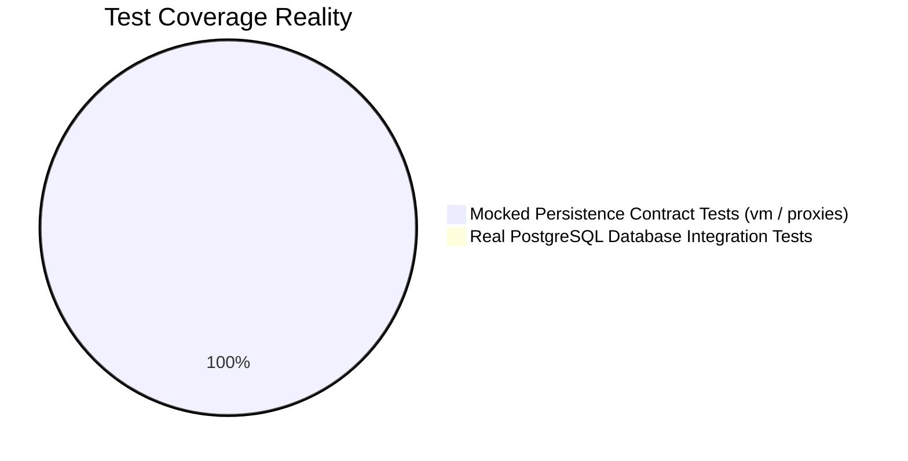
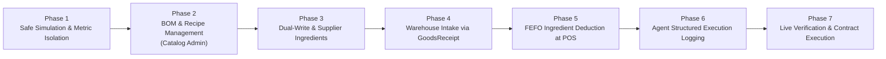

# PROJECT VERIFICATION AND DATABASE INTEGRATION AUDIT

> **Baseline Analysis**: [`docs/PROJECT_SOURCE_ANALYSIS.md`](file:///d:/KLTN/source/cafe-project/docs/PROJECT_SOURCE_ANALYSIS.md)  
> **Audit Objective**: Verify all findings directly against source code, establish database integration status, trace legacy dependencies, evaluate test coverage, and determine safe implementation sequencing.  
> **Repository Path**: `d:\KLTN\source\cafe-project`  
> **Verification Date**: 2026-11-04  
> **Mode**: Read-Only Source Code & Schema Inspection (Zero Side Effects)

---

## 1. EXECUTIVE SUMMARY & VERIFICATION OVERVIEW

| Verification Area | Status | Summary of Evidence-Based Verification |
|---|---|---|
| **Prisma Schema Models** | **VERIFIED & CLARIFIED** | Total of **31 models** defined across schema files (not 27). The "27 tables" represents the target state after dropping 4 legacy models. |
| **Actual Database Integration** | **CONFIRMED 15/31** | **15 models** are actively queried in source code (11 target models + 4 legacy models). **16 target models have ZERO reads/writes** in any application code. |
| **Legacy Dependencies** | **CRITICAL LOCK-IN** | The application cannot function without `Inventory`, `InventoryBatch`, `SupplierProduct`, and `AgentLog`. All raw SQL queries target `Inventory`. |
| **Business Workflows** | **VERIFIED WITH CAVEATS** | Ordering, FEFO batching, dynamic threshold math, simulation harness, and agent reordering match code. Payment gateway is simulated/manual. |
| **Test Proof vs Implementation** | **UNIT MOCK ONLY** | 100% of existing tests run against in-memory mocks (`vm.runInNewContext` / module proxies). **Zero integration tests** run against real PostgreSQL. |
| **Migration 04_contract Safety** | **STRICTLY BLOCKED** | Running `04_contract_DO_NOT_RUN_YET.sql` will instantly cause fatal HTTP 500 errors across the application. |

---

## 2. ACTUAL DATABASE INTEGRATION STATUS

A complete static scan of all Prisma calls (`prisma.<model>` and `tx.<model>`) across `apps/api/src/**/*.ts` and `apps/agent/src/**/*.ts` produced the following exact distribution:

### 2.1. Integrated Models (15 Models Total)

These 15 models are actively queried, inserted, updated, and deleted by backend business logic:

| Model Name | Table Type | API Hits | Agent Hits | Total Hits | Key Functional Role in System |
|---|---|:---:|:---:|:---:|---|
| [`Inventory`](file:///d:/KLTN/source/cafe-project/packages/database/prisma/schema/inventory.prisma#L162) | **LEGACY** | 33 | 2 | **35** | Product stock levels, reserved stock, min thresholds. (Includes 7 raw SQL statements). |
| [`InventoryTransaction`](file:///d:/KLTN/source/cafe-project/packages/database/prisma/schema/inventory.prisma#L91) | Target (1) | 19 | 1 | **20** | Immutable ledger for stock movements (`IMPORT`, `ORDER`, `CANCEL`, `ADJUSTMENT`, `SIMULATE_SALE`). |
| [`PurchaseRequest`](file:///d:/KLTN/source/cafe-project/packages/database/prisma/schema/purchase.prisma#L16) | Target (2) | 20 | 2 | **22** | Procurement requests created manually or autonomously by AI Agent. |
| [`AgentLog`](file:///d:/KLTN/source/cafe-project/packages/database/prisma/schema/system.prisma#L88) | **LEGACY** | 13 | 7 | **20** | Flat audit log of AI Agent scans, recommendations, simulations, and background events. |
| [`InventoryBatch`](file:///d:/KLTN/source/cafe-project/packages/database/prisma/schema/inventory.prisma#L177) | **LEGACY** | 18 | 0 | **18** | Product batch lots with expiration dates used for FEFO inventory deductions. |
| [`User`](file:///d:/KLTN/source/cafe-project/packages/database/prisma/schema/user.prisma#L7) | Target (3) | 15 | 1 | **16** | Authentication, password reset tokens, roles (`ADMIN`, `STAFF`, `CUSTOMER`). |
| [`SupplierProduct`](file:///d:/KLTN/source/cafe-project/packages/database/prisma/schema/supplier.prisma#L42) | **LEGACY** | 14 | 1 | **15** | Supplier-to-product mapping with prices, MOQ, lead times, and unit packaging conversions. |
| [`Product`](file:///d:/KLTN/source/cafe-project/packages/database/prisma/schema/product.prisma#L7) | Target (4) | 13 | 1 | **14** | Product catalog master, SKU generation, pricing, soft delete grace periods. |
| [`Order`](file:///d:/KLTN/source/cafe-project/packages/database/prisma/schema/order.prisma#L49) | Target (5) | 13 | 0 | **13** | Customer sales orders with shipping fees, zones, and status progression. |
| [`PurchaseRequestItem`](file:///d:/KLTN/source/cafe-project/packages/database/prisma/schema/purchase.prisma#L48) | Target (6) | 6 | 4 | **10** | Line items for purchase requests (currently linking `productId` & `inventoryId`). |
| [`Supplier`](file:///d:/KLTN/source/cafe-project/packages/database/prisma/schema/supplier.prisma#L1) | Target (7) | 8 | 0 | **8** | Supplier directory with contact emails, addresses, and active flags. |
| [`Category`](file:///d:/KLTN/source/cafe-project/packages/database/prisma/schema/category.prisma#L6) | Target (8) | 7 | 0 | **7** | Catalog beverage groupings (`kind = 'PRODUCT'`). |
| [`SystemSetting`](file:///d:/KLTN/source/cafe-project/packages/database/prisma/schema/system.prisma#L81) | Target (9) | 3 | 1 | **4** | Dynamic system key-values (`ai.enabled`, `ai.scanCron`, `store.name`, etc.). |
| [`OrderItem`](file:///d:/KLTN/source/cafe-project/packages/database/prisma/schema/order.prisma#L73) | Target (10) | 1 | 2 | **3** | Order line items with sales velocity aggregation for dynamic threshold calculation. |
| [`Payment`](file:///d:/KLTN/source/cafe-project/packages/database/prisma/schema/order.prisma#L114) | Target (11) | 3 | 0 | **3** | Payment records attached to orders with manual status updates (`PENDING`, `PAID`). |

---

### 2.2. Unintegrated Models (16 Models Total - 0 Hits)

The following 16 models are defined in [`packages/database/prisma/schema/`](file:///d:/KLTN/source/cafe-project/packages/database/prisma/schema), but have **ZERO queries, reads, or writes** in `apps/api/src` or `apps/agent/src`:

| # | Unintegrated Model Name | Domain | Intended Purpose in 27-Table Model | Current Reality in Source Code |
|---|---|---|---|---|
| 1 | `Ingredient` | Inventory | Raw material catalog (e.g. coffee beans, milk, sugar) | **Zero usage**. Stock is managed directly on finished `Product` via `Inventory`. |
| 2 | `IngredientBatch` | Inventory | Raw material lot numbers & expiration dates | **Zero usage**. Batches are tracked on `InventoryBatch`. |
| 3 | `StockCount` | Inventory | Physical inventory audit headers (counts) | **Zero usage**. No audit or reconciliation workflows exist. |
| 4 | `StockCountItem` | Inventory | Variance tracking between system and actual stock | **Zero usage**. |
| 5 | `Recipe` | Catalog / BOM | Bill of materials linking `Product` to ingredients | **Zero usage**. Cafe drinks have no recipe definitions in code. |
| 6 | `RecipeIngredient` | Catalog / BOM | Quantity and base unit per recipe ingredient | **Zero usage**. |
| 7 | `Topping` | Catalog / BOM | Add-ons / modifications (e.g. extra pearl, syrup) | **Zero usage**. |
| 8 | `ToppingIngredient` | Catalog / BOM | Raw materials consumed by toppings | **Zero usage**. |
| 9 | `OrderItemTopping` | Sales | Customer topping selections on order items | **Zero usage**. |
| 10 | `GoodsReceipt` | Procurement | Formal warehouse intake receipt for purchase orders | **Zero usage**. Receiving directly updates `Inventory` & `InventoryBatch`. |
| 11 | `SupplierIngredient` | Procurement | Supplier raw material catalog, pricing, MOQ | **Zero usage**. Supplier links are stored on `SupplierProduct`. |
| 12 | `PaymentCallback` | Payment | Asynchronous IPN webhook logs from payment gateways | **Zero usage**. No webhook endpoint exists in `apps/api`. |
| 13 | `PaymentReconciliation` | Payment | Daily financial reconciliation between gateway & system | **Zero usage**. |
| 14 | `AgentExecution` | AI Agent | Structured multi-step agent execution runs | **Zero usage**. Agent logs to flat `AgentLog` table. |
| 15 | `AgentToolCall` | AI Agent | Granular logging of individual agent tool invocations | **Zero usage**. |
| 16 | `AgentEvaluation` | AI Agent | Test benchmarks, tool call accuracy, latency metrics | **Zero usage**. |

---

## 3. TRACING DEPENDENCIES ON LEGACY DATABASE TABLES

Four tables are officially marked as **Transitional Legacy Models** in the Prisma schema and the migration scripts. The application has deep, structural dependencies on them:

```mermaid
flowchart TD
    subgraph Legacy_Tables ["Transitional Legacy Tables (Pending Contract Phase)"]
        LegacyInv["Inventory\n(Product-level Stock)"]
        LegacyBatch["InventoryBatch\n(Product-level Batches)"]
        LegacySupp["SupplierProduct\n(Product-Supplier Links)"]
        LegacyLog["AgentLog\n(Agent Audit Records)"]
    end

    subgraph API_Services ["Core API Services (apps/api)"]
        InvService["inventory.service.ts"]
        OrderRepo["order.repository.ts"]
        SimService["simulate-sale.service.ts"]
        PurchService["purchase.service.ts"]
        DashService["dashboard.service.ts"]
        FailLogService["agent-failure-log.service.ts"]
    end

    subgraph Agent_Services ["AI Agent Services (apps/agent)"]
        AgentRepo["agent.repository.ts"]
        RecomService["recommendation.service.ts"]
        AgentCore["agent.service.ts"]
    end

    subgraph Frontend_App ["Frontend Client (apps/web)"]
        WebAdmin["AdminInventoryPage.tsx\nAdminSuppliersPage.tsx\nAdminAgentLogsPage.tsx"]
    end

    InvService -->|"Reads & Mutates"| LegacyInv
    InvService -->|"Creates Batches"| LegacyBatch
    InvService -->|"Reads Lead Time & Units"| LegacySupp
    OrderRepo -->|"Locks & Reserves Stock"| LegacyInv
    OrderRepo -->|"Deducts via FEFO"| LegacyBatch
    SimService -->|"Direct Stock Depletion"| LegacyInv
    PurchService -->|"Converts Packaging Units"| LegacySupp
    DashService -->|"Low Stock Metric Counts"| LegacyInv
    DashService -->|"Agent KPI Counters"| LegacyLog
    FailLogService -->|"Writes Fallback Logs"| LegacyLog

    AgentRepo -->|"Queries Active Stock"| LegacyInv
    AgentRepo -->|"Selects Best Supplier"| LegacySupp
    AgentRepo -->|"Writes Execution Logs"| LegacyLog
    RecomService -->|"Calculates Dynamic Reorder"| LegacyInv
    RecomService -->|"Rounds to Packaging Unit"| LegacySupp
    AgentCore -->|"Reads Audit History"| LegacyLog

    WebAdmin -->|"Consumes DTOs derived from"| LegacyInv
    WebAdmin -->|"Displays Logs from"| LegacyLog
```



### 3.1. Detailed Dependency Breakdown

1. **`Inventory` Table Dependencies**:
   - **File**: [`apps/api/src/modules/inventory/inventory.repository.ts`](file:///d:/KLTN/source/cafe-project/apps/api/src/modules/inventory/inventory.repository.ts#L126)
     - Implements `SELECT "id" FROM "Inventory" WHERE "id" = $1 FOR UPDATE` to lock records during manual adjustments and stock imports.
   - **File**: [`apps/api/src/modules/order/order.repository.ts`](file:///d:/KLTN/source/cafe-project/apps/api/src/modules/order/order.repository.ts#L96)
     - Implements raw atomic reservation query:
       ```sql
       UPDATE "Inventory"
       SET "reservedStock" = "reservedStock" + $1
       WHERE "productId" = $2 AND "quantity" - "reservedStock" >= $1
       ```
   - **File**: [`apps/agent/src/repositories/agent.repository.ts`](file:///d:/KLTN/source/cafe-project/apps/agent/src/repositories/agent.repository.ts#L125)
     - Implements `prisma.inventory.findMany` to retrieve stock levels for scanning.
2. **`InventoryBatch` Table Dependencies**:
   - **File**: [`apps/api/src/modules/order/order.repository.ts`](file:///d:/KLTN/source/cafe-project/apps/api/src/modules/order/order.repository.ts#L165-L219)
     - Iterates over `tx.inventoryBatch.findMany` with `expirationDate >= startOfToday` ordered by `expirationDate ASC` to deduct stock using FEFO.
   - **File**: [`apps/api/src/modules/inventory/inventory.service.ts`](file:///d:/KLTN/source/cafe-project/apps/api/src/modules/inventory/inventory.service.ts#L91)
     - Exposes batch breakdowns to frontend clients.
3. **`SupplierProduct` Table Dependencies**:
   - **File**: [`apps/agent/src/services/recommendation.service.ts`](file:///d:/KLTN/source/cafe-project/apps/agent/src/services/recommendation.service.ts#L215-L226)
     - Extracts supplier pricing, MOQ, lead times, and unit conversion metadata (`purchaseUnit`, `conversionQuantity`, `conversionTargetUnit`).
   - **File**: [`apps/api/src/modules/purchase/purchase.service.ts`](file:///d:/KLTN/source/cafe-project/apps/api/src/modules/purchase/purchase.service.ts#L24-L52)
     - Uses `SupplierProduct` to compute packaging math for purchase requests.
4. **`AgentLog` Table Dependencies**:
   - **File**: [`apps/agent/src/repositories/agent.repository.ts`](file:///d:/KLTN/source/cafe-project/apps/agent/src/repositories/agent.repository.ts#L362-L395)
     - Inserts and updates agent actions. Contains deduplication logic for simulation scans.
   - **File**: [`apps/api/src/modules/agent/agent-failure-log.service.ts`](file:///d:/KLTN/source/cafe-project/apps/api/src/modules/agent/agent-failure-log.service.ts#L99)
     - Direct fallback logging when the agent microservice on port 5055 is unreachable.

---

## 4. VERIFICATION OF DOCUMENTED BUSINESS WORKFLOWS

We verified the 7 core business workflows documented in [`docs/PROJECT_SOURCE_ANALYSIS.md`](file:///d:/KLTN/source/cafe-project/docs/PROJECT_SOURCE_ANALYSIS.md#6-business-features-and-workflows) directly against implementation files:

### 4.1. Authentication & RBAC Lifecycle: **VERIFIED**
- **Evidence**:
  - `registerUser` in [`auth.service.ts:159`](file:///d:/KLTN/source/cafe-project/apps/api/src/modules/auth/auth.service.ts#L159) hardcodes `role: 'CUSTOMER'`.
  - Password hashing in [`auth.service.ts:150`](file:///d:/KLTN/source/cafe-project/apps/api/src/modules/auth/auth.service.ts#L150) uses `bcrypt.hash(password, 10)`.
  - Role enforcement in [`auth.middleware.ts:40-54`](file:///d:/KLTN/source/cafe-project/apps/api/src/modules/auth/auth.middleware.ts#L40-L54) verifies that `req.user.role` matches allowed roles (`ADMIN`, `STAFF`, `CUSTOMER`).

### 4.2. Product Soft-Delete & 7-Day Purge: **VERIFIED**
- **Evidence**:
  - `scheduleDelete` in [`product.service.ts:300-309`](file:///d:/KLTN/source/cafe-project/apps/api/src/modules/product/product.service.ts#L300-L309) calculates `pendingDeleteUntil = now + 7 days` and marks `isActive = false`.
  - Permanent purge blocker checks in [`product.service.ts:153-177`](file:///d:/KLTN/source/cafe-project/apps/api/src/modules/product/product.service.ts#L153-L177) prevent deleting products linked to orders, transactions, or purchase requests.
  - Automated purge cron in [`cron.service.ts:18-53`](file:///d:/KLTN/source/cafe-project/apps/api/src/modules/cron/cron.service.ts#L18-L53) executes daily at `0 0 * * *`.

### 4.3. Customer Ordering & Concurrency Reservation: **VERIFIED**
- **Evidence**:
  - Order creation in [`order.repository.ts:96-105`](file:///d:/KLTN/source/cafe-project/apps/api/src/modules/order/order.repository.ts#L96-L105) runs atomic SQL reservation.
  - If available stock is insufficient, the transaction throws `HttpError(400, "Không đủ tồn kho khả dụng để tạo đơn hàng")`.
  - Confirmed: Shipping fee detection via address regex in [`shipping.service.ts`](file:///d:/KLTN/source/cafe-project/apps/api/src/modules/order/shipping.service.ts).

### 4.4. FEFO Batch Deduction on Completion: **VERIFIED WITH CRITICAL CAVEAT**
- **Evidence**:
  - Deduction in [`order.repository.ts:165-219`](file:///d:/KLTN/source/cafe-project/apps/api/src/modules/order/order.repository.ts#L165-L219) sorts batches by `expirationDate ASC, id ASC` where `expirationDate >= startOfToday`.
  - **Verified Flaw / Edge Case**: Specific batches are not locked at order creation. If an order sits in `PENDING` or `PROCESSING` while all available batches expire, attempting to mark the order `COMPLETED` throws an unhandled error: `"Không đủ lô hàng còn hạn để xuất"`.

### 4.5. Dynamic Threshold Suggestion Algorithm: **VERIFIED**
- **Evidence**:
  - Mathematical implementation in [`inventory.service.ts:500-545`](file:///d:/KLTN/source/cafe-project/apps/api/src/modules/inventory/inventory.service.ts#L500-L545):
    - `salesWindowDays = 30`
    - `leadTimeDemand = ceil(baseDailySales * effectiveLeadTimeDays)`
    - `safetyStock = max(1, ceil(baseDailySales * bufferDays))`
    - `recommendedThreshold = ceil(leadTimeDemand + safetyStock)`

### 4.6. Autonomous AI Agent Monitoring & Reorder Flow: **VERIFIED**
- **Evidence**:
  - Internal server runs in [`apps/agent/src/server.ts`](file:///d:/KLTN/source/cafe-project/apps/agent/src/server.ts) on port 5055.
  - Duplicate suppression in [`agent.repository.ts:134-144`](file:///d:/KLTN/source/cafe-project/apps/agent/src/repositories/agent.repository.ts#L134-L144) checks if active PR already exists in `['PENDING', 'APPROVED', 'SENT']`.
  - Gemini prompt construction in [`gemini.service.ts`](file:///d:/KLTN/source/cafe-project/apps/agent/src/services/gemini.service.ts) and fallback math in [`recommendation.service.ts:324-356`](file:///d:/KLTN/source/cafe-project/apps/agent/src/services/recommendation.service.ts#L324-L356).
  - Purchase request creation in [`agent.repository.ts:246-267`](file:///d:/KLTN/source/cafe-project/apps/agent/src/repositories/agent.repository.ts#L246-L267) sets `aiGenerated = true`.

### 4.7. Purchase Request Lifecycle & Goods Intake: **VERIFIED**
- **Evidence**:
  - State progression in [`purchase.service.ts`](file:///d:/KLTN/source/cafe-project/apps/api/src/modules/purchase/purchase.service.ts):
    `PENDING` $\rightarrow$ `APPROVED` $\rightarrow$ `SENT` $\rightarrow$ `RECEIVED` $\rightarrow$ `COMPLETED`.
  - Receiving in [`purchase.repository.ts:154-205`](file:///d:/KLTN/source/cafe-project/apps/api/src/modules/purchase/purchase.repository.ts#L154-L205) updates `quantityReceived`, increments `Inventory.quantity`, provisions `InventoryBatch`, and records an `IMPORT` transaction.

---

## 5. DISTINGUISHING IMPLEMENTED CODE FROM TEST-PROVEN FUNCTIONALITY

A strict inspection of all tests in `apps/api/tests/` and `apps/agent/tests/` reveals a critical distinction between what is **implemented in code** versus what is **proven by automated tests**:



| Domain / Feature | Implemented in Code? | Proven by Automated Tests? | Test Verification Mechanism in Repository |
|---|:---:|:---:|---|
| **Role-Based Guards (RBAC)** | YES | **YES** | Tested in [`apps/api/tests/test-db-security.test.cjs`](file:///d:/KLTN/source/cafe-project/apps/api/tests/test-db-security.test.cjs) via mocked Express app. |
| **Agent Internal Auth Token** | YES | **YES** | Tested in [`apps/agent/tests/internal-auth.test.cjs`](file:///d:/KLTN/source/cafe-project/apps/agent/tests/internal-auth.test.cjs) verifying secret strength & 401 response. |
| **Agent Rule-Based Fallback Math** | YES | **YES** | Tested in [`apps/agent/tests/rule-based-regression.test.cjs`](file:///d:/KLTN/source/cafe-project/apps/agent/tests/rule-based-regression.test.cjs) with stubbed module repository. |
| **Inventory State Consistency** | YES | **PARTIAL** | Tested in [`apps/api/tests/inventory-consistency.test.cjs`](file:///d:/KLTN/source/cafe-project/apps/api/tests/inventory-consistency.test.cjs) using JS object clone `structuredClone(state)`. **Header explicitly notes: "NOT PostgreSQL concurrency/rollback proof."** |
| **PostgreSQL Real Concurrency & Locks** | YES | **NO** | `SELECT ... FOR UPDATE` and raw SQL atomic updates have never been run against a concurrent multi-connection PostgreSQL instance in automated tests. |
| **Real Database Foreign Key Cascades** | YES | **NO** | Zero integration tests verify foreign key constraint cascades or schema referential integrity. |
| **Cloudinary Upload & Delete** | YES | **NO** | Cloudinary integration is mocked or untested in CI/CD pipeline. |
| **SMTP Email Delivery** | YES | **NO** | Nodemailer delivery is not verified in end-to-end tests. |
| **Gemini Generative API Live Calls** | YES | **NO** | Live LLM responses and prompt token processing are mocked. |

---

## 6. INCONSISTENCIES, UNSUPPORTED CLAIMS & CORRECTIONS IN BASELINE ANALYSIS

Comparing [`docs/PROJECT_SOURCE_ANALYSIS.md`](file:///d:/KLTN/source/cafe-project/docs/PROJECT_SOURCE_ANALYSIS.md) against verified source code reveals the following discrepancies that must be officially corrected:

### Correction 01: Total Schema Model Count
- **Baseline Report Stated**: "The database has 27 tables defined in Prisma schema...".
- **Verified Reality**: The Prisma schema actually defines **31 models**, not 27.
- **Root Cause of Confusion**: The baseline report conflated the *target* model count ($31 - 4 = 27$) with the *current* model count in the `.prisma` files ($31$). The 4 transitional legacy models are still fully present in the schema.

### Correction 02: Model Integration Distribution
- **Baseline Report Stated**: "...100% of the active backend application code still runs on the 4 legacy models".
- **Verified Reality**: While 100% of the inventory/agent logic relies on the 4 legacy models, the application simultaneously reads and writes to **11 non-legacy target models** (`User`, `Category`, `Product`, `Order`, `OrderItem`, `Payment`, `PurchaseRequest`, `PurchaseRequestItem`, `Supplier`, `SystemSetting`, `InventoryTransaction`). Exactly **16 target models** have 0% integration.

### Correction 03: Payment Integration Status
- **Baseline Report Stated**: Payment Gateway Integration is classified as `PARTIAL`.
- **Verified Reality**: As an automated payment gateway, it is **`NOT_IMPLEMENTED`**. While internal database recording of payments exists, there is zero integration with external payment gateways (no VNPay SDK, no MoMo payment URL generation, no VietQR dynamic payload generation, and no webhook receiver for IPN callbacks). Classifying it as `PARTIAL` gave an overly optimistic impression of gateway readiness.

### Correction 04: Agent Execution Tracking
- **Baseline Report Stated**: Listed `AgentExecution` and `AgentToolCall` as target models.
- **Verified Reality**: In `apps/agent/src/server.ts`, the agent server has no concept of executions or steps. Although `02_migrate_data.sql` attempts a one-time copy of `AgentLog` into `AgentExecution` and `AgentToolCall`, no application code writes to those tables. Any new agent executions continue to write strictly to `AgentLog`.

---

## 7. CRITICAL BLOCKERS FOR FURTHER DEVELOPMENT

```
+----------------------------------------------------------------------------------------------------+
|                                      CRITICAL ARCHITECTURAL GAPS                                    |
+------------------------------------+---------------------------------------------------------------+
| G-01: Legacy Schema Contract Lock  | Executing 04_contract will drop Inventory, InventoryBatch,    |
|                                    | SupplierProduct, and AgentLog, causing total system crash.    |
+------------------------------------+---------------------------------------------------------------+
| G-02: Cafe Recipe / BOM Absence    | Drinks are stocked directly as finished goods. No ingredients |
|                                    | or recipes are deducted upon ordering.                        |
+------------------------------------+---------------------------------------------------------------+
| G-03: Pending Order FEFO Expiry    | Orders created with reserved stock fail completion if batches |
|                                    | reach their expiration date before staff confirm delivery.   |
+------------------------------------+---------------------------------------------------------------+
| G-04: Simulation Metric Pollution  | Simulated sales artificially inflate 30-day velocity used by  |
|                                    | the AI Agent, distorting future reorder suggestions.          |
+------------------------------------+---------------------------------------------------------------+
| G-05: Zero DB Integration Tests    | No tests verify real PostgreSQL concurrency, transactions, or |
|                                    | rollback safety under real database workloads.                |
+------------------------------------+---------------------------------------------------------------+
```

---

## 8. RECOMMENDED IMPLEMENTATION PRIORITIES & ROADMAP

To transition from the current working product-based system to the comprehensive 27-table ingredient/recipe system **without breaking existing functionality or causing regression**, development must strictly follow this phased sequence:



### Phase 1: Metric Isolation & Concurrency Hardening (Immediate)
1. **Isolate Simulation Metrics**: Modify [`inventory.service.ts:250`](file:///d:/KLTN/source/cafe-project/apps/api/src/modules/inventory/inventory.service.ts#L250) to exclude `SIMULATE_SALE` transactions from production sales velocity calculations unless explicitly requested by a demo flag.
2. **Order Expiration Grace Handling**: Update [`order.repository.ts:165`](file:///d:/KLTN/source/cafe-project/apps/api/src/modules/order/order.repository.ts#L165) to handle orders whose reserved stock batches expired while pending, providing a staff override or alert rather than an unrecoverable transaction abort.

### Phase 2: Recipe & BOM Management (Non-Destructive)
1. Implement REST API controllers and services for `Recipe`, `RecipeIngredient`, `Topping`, and `ToppingIngredient`.
2. Populate base ingredients into `Ingredient` (Coffee beans, Milk, Sugar, Cups, Syrups).
3. Allow admin staff to define drink recipes on the web dashboard while continuing to run existing stock operations on `Inventory`.

### Phase 3: Supplier Ingredient Mapping & Dual-Writing
1. Implement `SupplierIngredient` CRUD and link ingredients to existing suppliers.
2. Update `PurchaseRequestItem` to accept both `ingredientId` and `productId`.
3. Introduce dual-writing in [`purchase.repository.ts`](file:///d:/KLTN/source/cafe-project/apps/api/src/modules/purchase/purchase.repository.ts): receiving goods increments `Ingredient` stock in addition to `Inventory`.

### Phase 4: Procurement Intake via `GoodsReceipt`
1. Route purchase order receiving through the `GoodsReceipt` entity.
2. Create `IngredientBatch` records alongside legacy `InventoryBatch` records.

### Phase 5: POS Order Consumption via Recipes
1. When orders transition to `COMPLETED`, look up the product's active `Recipe`.
2. Deduct raw materials from `IngredientBatch` using FEFO while maintaining backward-compatible `Inventory` counts.

### Phase 6: Agent Observability Transition
1. Refactor [`apps/agent/src/server.ts`](file:///d:/KLTN/source/cafe-project/apps/agent/src/server.ts) to record runs into `AgentExecution` and tool calls into `AgentToolCall`.
2. Provide a migration adapter so the web dashboard can display unified logs from both tables.

### Phase 7: Verification & Final Contract
1. Run [`03_verify.sql`](file:///d:/KLTN/source/cafe-project/packages/database/prisma/migration_27_tables/03_verify.sql) against live data to confirm 100% parity across all counts.
2. Once verified that zero application code references `Inventory`, `InventoryBatch`, `SupplierProduct`, or `AgentLog`, unlock and execute [`04_contract_DO_NOT_RUN_YET.sql`](file:///d:/KLTN/source/cafe-project/packages/database/prisma/migration_27_tables/04_contract_DO_NOT_RUN_YET.sql).

---

## 9. CONCLUSION

The existing system is **production-functional on its legacy product-inventory architecture**. The 27-table expansion exists in schema and SQL scripts, but is largely unhooked from application code. Future development must **never rush the contract phase**; instead, developers must build backward-compatible adapters for recipes and ingredients before retiring the legacy tables.

